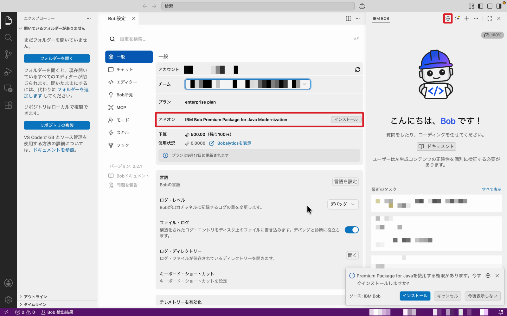
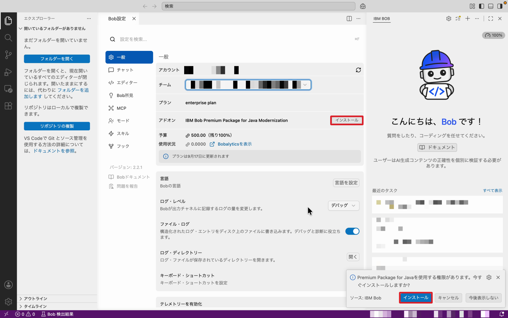
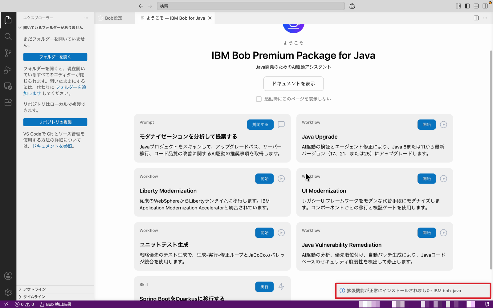
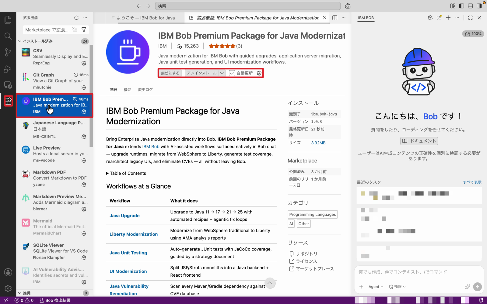

# Java Premium Package - 準備編

IBM Bob Premium Package for Java Modernization（以下、Java Modernization パッケージ）のハンズオンを始める前に、必要なツールを準備します。

!!! warning "はじめにお読みください"
    - **生成 AI の出力にはブレがあります。** 同じ操作をしても、Bob の提案内容が毎回同じになるとは限りません。ハンズオン内の出力例はあくまで参考です。
    - **インストール手順は変わることがあります。** 本ページの手順でうまくいかない場合は、各セクションに記載した公式ドキュメントを参照してください。

!!! info "公式ドキュメント"
    前提条件の詳細は、IBM Bob 公式ドキュメントの [Java Modernization - Prerequisites](https://bob.ibm.com/docs/ide/premium-packages/java-modernization/prerequisites) を参照してください。

---

## ⏱️ 所要時間

| セクション | 時間 |
|-----------|------|
| 1. システム要件の確認 | 10 分 |
| 2. Java バージョン管理ツールの準備 | 10〜15 分 |
| 3. Java Modernization パッケージのインストール | 5 分 |

**合計**: 約 25〜30 分

---

## 1. システム要件の確認

まず、以下の要件を満たしているか確認します。

| 要件 | 内容 |
|------|------|
| **Java Development Kit (JDK)** | JDK 8 以上。移行先の JDK（例：JDK 21）も事前にインストールしておくことを推奨。Bob が SDKMan / WinGet 経由でインストールすることも可能 |
| **IBM Bob** | バージョン 2.0.0 以降がインストール済みで、ログイン（認証）済みであること |
| **Java Modernization パッケージ** | IBM Bob Premium Package for Java Modernization の有効なライセンス |
| **Git** | ブランチやプルリクエストを管理する Git フロー機能を使う場合に必要 |

### 1-1. JDK を確認する

ターミナルで以下を実行し、現在の Java のバージョンを確認します。

```bash
java -version
javac -version
```

**出力例**

```text
openjdk version "1.8.0_412"
OpenJDK Runtime Environment (Temurin)(build 1.8.0_412-b08)
```

`java` コマンドが見つからない場合は、次の「2. Java バージョン管理ツールの準備」で JDK をインストールしてください。

### 1-2. IBM Bob のバージョンを確認する

1. Bob を起動する
2. メニューからバージョン情報（About）を開く
3. バージョンが **2.0.0 以降** であることを確認する

2.0.0 未満の場合は、最新版にアップデートしてください。あわせて、Bob にログインできていることも確認します。

!!! info "公式ドキュメント"
    - Bob のダウンロード：[IBM Bob ダウンロードページ](https://bob.ibm.com/download)
    - インストール・セットアップ：[IBM Bob ドキュメント](https://bob.ibm.com/docs/ide/)

### 1-3. Java Modernization パッケージのライセンスを確認する

Java Modernization パッケージは **Premium Package（有償の追加ライセンス）** です。ハンズオンで使用するライセンスについては、**ハンズオンの講師に確認してください**。ライセンスが割り当てられているかどうかは、「3-1. ライセンスにパッケージが紐づいていることを確認する」の手順で確認できます。

!!! info "管理者の方へ"
    Premium Package をユーザーに割り当てる方法は、公式ドキュメントの [Managing premium packages](https://bob.ibm.com/docs/ide/enterprise/getting-started/users#managing-premium-packages) を参照してください。

### 1-4. Git を確認する

```bash
git --version
```

`git version 2.x.x` のように表示されれば OK です。表示されない場合はインストールしてください。

!!! info "公式ドキュメント"
    - Git のインストール：[Git - Downloads](https://git-scm.com/downloads)

---

## 2. Java バージョン管理ツールの準備

Bob はワークフローの途中で、移行先の Java をインストール・切り替えるためにバージョン管理ツールを使います。OS ごとに必要なツールが異なります。

=== "macOS / Linux（SDKMan）"

    ### SDKMan がインストール済みか確認する

    ```bash
    sdk version
    ```

    バージョンが表示されれば、インストール済みです。`command not found: sdk` と表示された場合は、以下の手順でインストールします。

    ### SDKMan をインストールする

    ```bash
    curl -s "https://get.sdkman.io" | bash
    ```

    !!! info "公式ドキュメント"
        - SDKMan のインストール：[SDKMAN! - Installation](https://sdkman.io/install/)
        - SDKMan の使い方（`sdk list` / `sdk install` など）：[SDKMAN! - Usage](https://sdkman.io/usage/)

    インストール後、シェルの設定ファイルで SDKMan が読み込まれていることを確認します。

    ```bash
    # zsh の場合
    grep sdkman ~/.zshrc

    # bash の場合
    grep sdkman ~/.bashrc
    ```

    以下のような行が含まれていれば OK です。

    ```bash
    export SDKMAN_DIR="$HOME/.sdkman"
    [[ -s "$HOME/.sdkman/bin/sdkman-init.sh" ]] && source "$HOME/.sdkman/bin/sdkman-init.sh"
    ```

    !!! note "ターミナルを再起動してください"
        設定を反映するために、**ターミナルを開き直してください**。Bob から SDKMan を認識させるため、**Bob も再起動**しておくと確実です。

    ### 移行先の JDK をインストールする（推奨）

    Bob にインストールしてもらうこともできますが、事前にインストールしておくとワークフローがスムーズに進みます。

    ```bash
    # インストール可能な JDK の一覧を表示
    sdk list java

    # 例：Temurin の JDK 21 をインストール（識別子は一覧に表示されたものを指定）
    sdk install java 21.0.5-tem

    # インストール済みのバージョンを確認
    sdk list java | grep installed
    ```

    !!! tip "デフォルトの Java について"
        インストール時に「デフォルトにするか」聞かれます。普段使っている Java を変えたくない場合は **No** を選んでください。切り替えは `sdk use java <識別子>` で行えます。

=== "Windows（WinGet）"

    ### WinGet がインストール済みか確認する

    PowerShell で以下を実行します。

    ```powershell
    winget --version
    ```

    `v1.x.x` のように表示されれば、インストール済みです。表示されない場合は、Microsoft Store から **アプリ インストーラー（App Installer）** をインストールしてください。

    !!! info "公式ドキュメント"
        - WinGet のインストール・使い方：[WinGet ツールを使用したアプリケーションのインストールと管理](https://learn.microsoft.com/ja-jp/windows/package-manager/winget/)

    !!! note "Bob とターミナルを再起動してください"
        WinGet をインストールしたら、**Bob と開いているターミナルをすべて再起動してください**。更新された PATH を Bob が認識できるようになります。

    ### 移行先の JDK をインストールする（推奨）

    ```powershell
    # インストール可能な JDK を検索
    winget search OpenJDK

    # 例：Microsoft Build of OpenJDK 21 をインストール
    winget install Microsoft.OpenJDK.21

    # インストールを確認
    winget list OpenJDK
    ```

    !!! info "公式ドキュメント"
        - Microsoft Build of OpenJDK のインストール：[Microsoft Build of OpenJDK のインストール](https://learn.microsoft.com/ja-jp/java/openjdk/install)
        - Eclipse Temurin を使う場合：[Adoptium - Installation](https://adoptium.net/ja/installation/)

---

## 3. Java Modernization パッケージのインストール

Java Modernization パッケージは、Bob の**拡張機能**として提供されています。ライセンスに紐づいていることを確認してから、拡張機能をインストールします。

### 3-1. ライセンスにパッケージが紐づいていることを確認する

1. Bob のチャットパネル右上の **⚙（設定）アイコン**をクリックし、「Bob設定」を開く
2. 左メニューの **「一般」** を選択する
3. **「アドオン」** の欄に **`IBM Bob Premium Package for Java Modernization`** が表示されていることを確認する



!!! warning "アドオンが「なし」と表示される場合"
    - 複数のチームに所属している場合は、**「チーム」** のプルダウンで、パッケージが割り当てられたチームを選択しているか確認してください。
    - それでも表示されない場合は、ライセンスが割り当てられていません。ハンズオンの講師に確認してください。

### 3-2. 拡張機能をインストールする

アドオン欄の右にある **「インストール」** をクリックします。

画面右下に「Premium Package for Java を使用する権限があります。今すぐインストールしますか？」という通知が表示された場合は、通知の **「インストール」** をクリックしてもインストールできます。



インストールが完了すると、画面右下に **「拡張機能が正常にインストールされました: IBM.bob-java」** と表示され、**「ようこそ — IBM Bob for Java」** のページが開きます。



このページには、ハンズオンで使用するワークフロー（Java Upgrade、Liberty Modernization、UI Modernization など）が並んでいます。

### 3-3. 拡張機能が有効になっていることを確認する

1. 左側のアクティビティバーで **拡張機能アイコン** をクリックする
2. 「インストール済み」の一覧に **`IBM Bob Premium Package for Java Modernization`** があることを確認し、クリックして詳細を開く
3. ボタンが **「無効にする」「アンインストール」** と表示されていることを確認する（これで拡張機能がオンになっています）



!!! tip "「有効にする」と表示されている場合"
    拡張機能がオフになっています。**「有効にする」** をクリックしてオンにしてください。

---

!!! success "準備完了"
    以下を確認できたら、ハンズオンの準備は完了です。

    - JDK 8 以上がインストールされている（移行先の JDK もインストール済みが推奨）
    - Bob 2.0.0 以降がインストール・ログイン済み
    - Java Modernization パッケージがライセンスに紐づいている
    - Git が使える
    - SDKMan（macOS / Linux）または WinGet（Windows）が使える
    - Java Modernization パッケージの拡張機能がインストールされ、有効になっている
