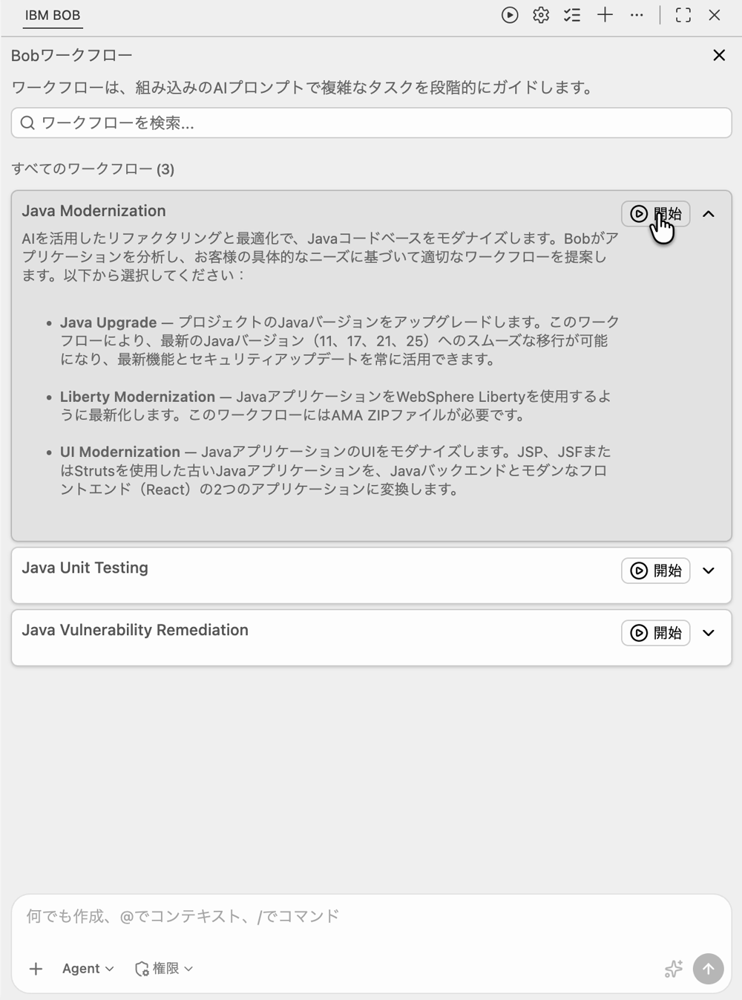
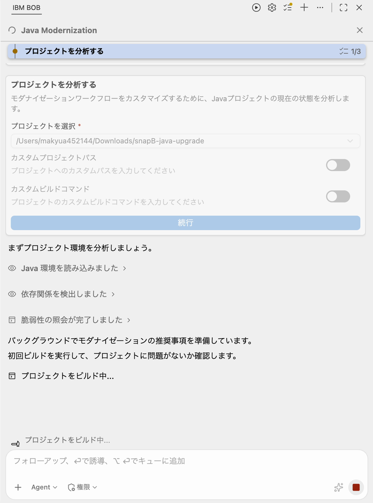
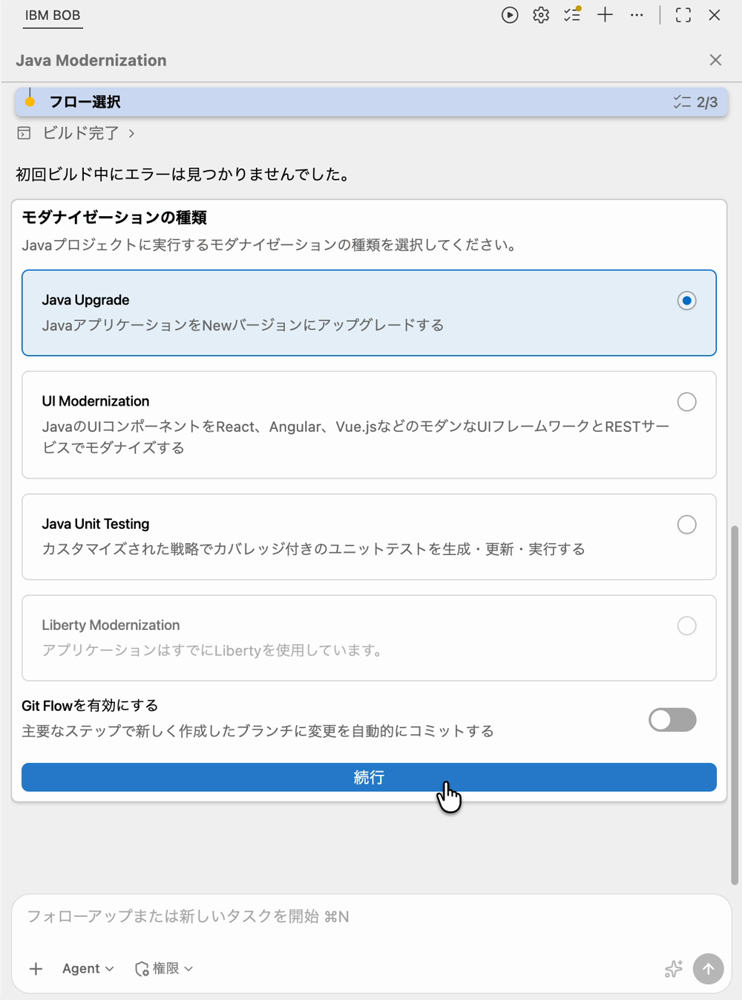
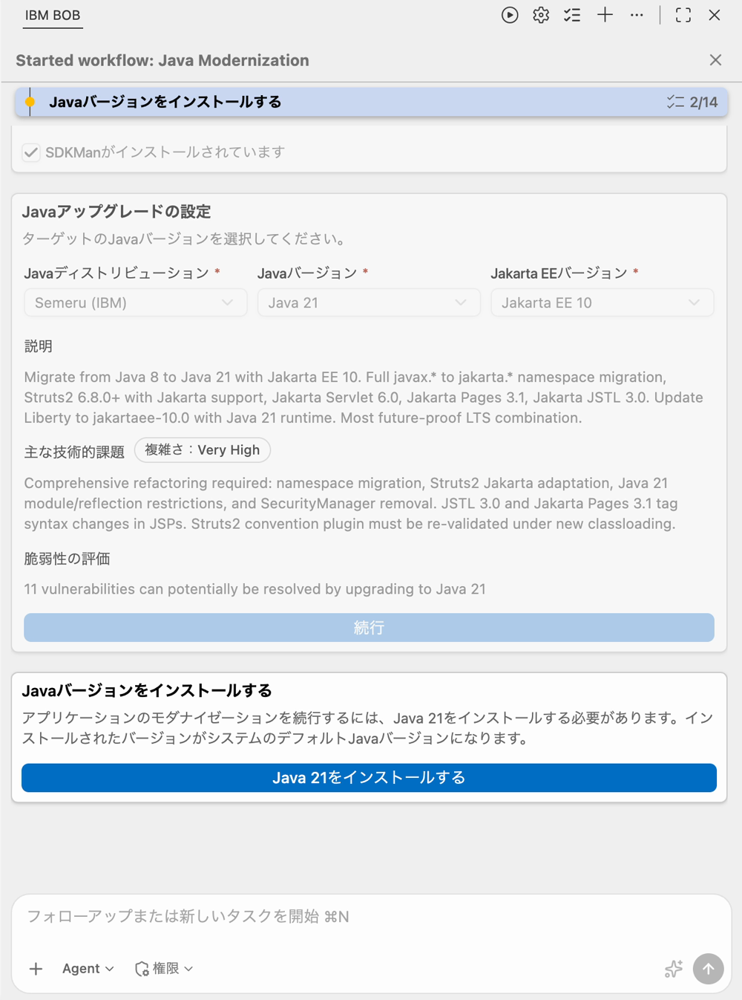
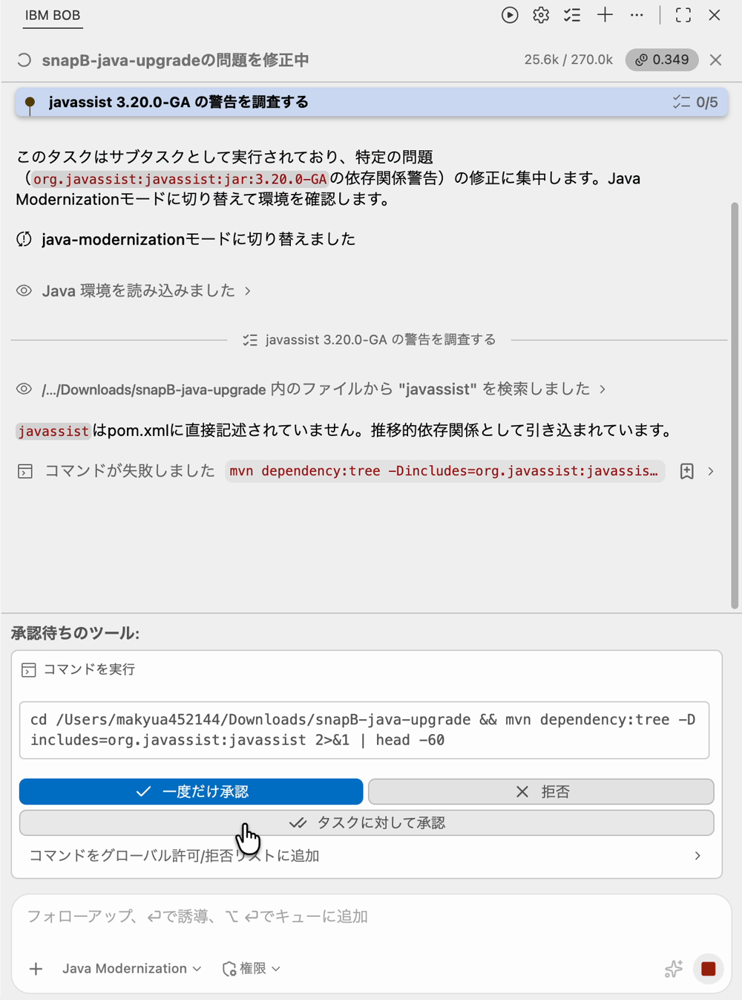
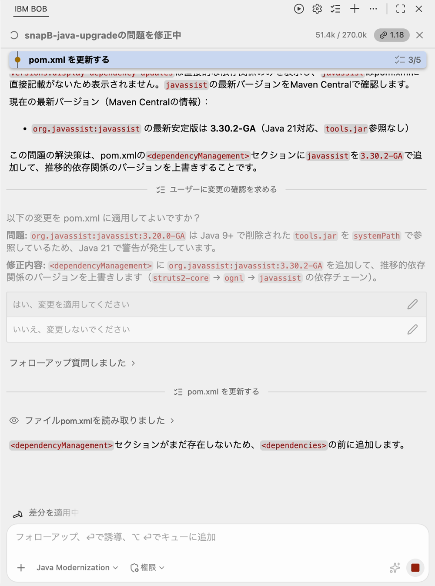
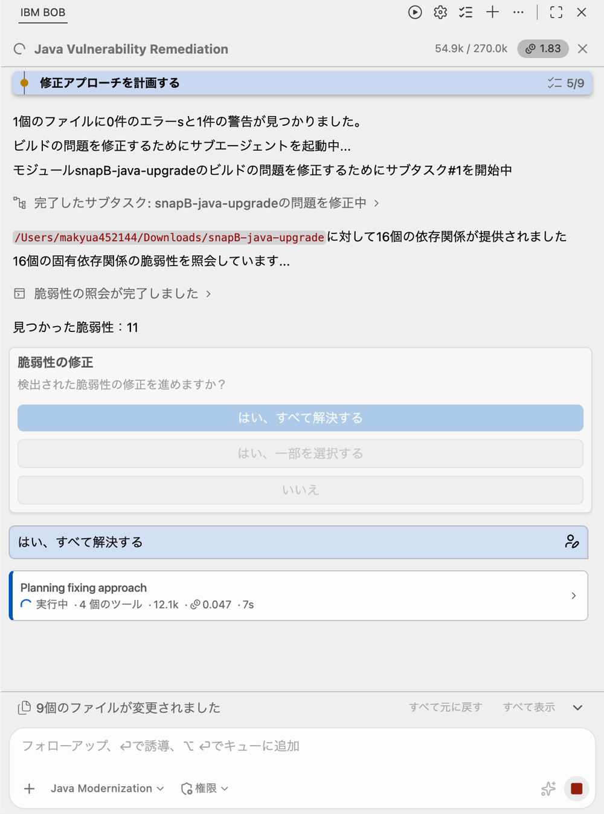
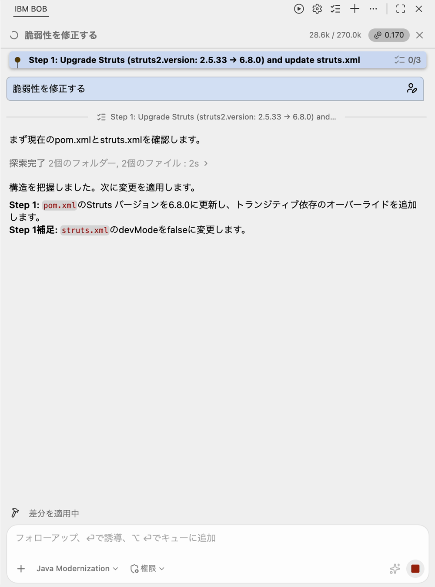
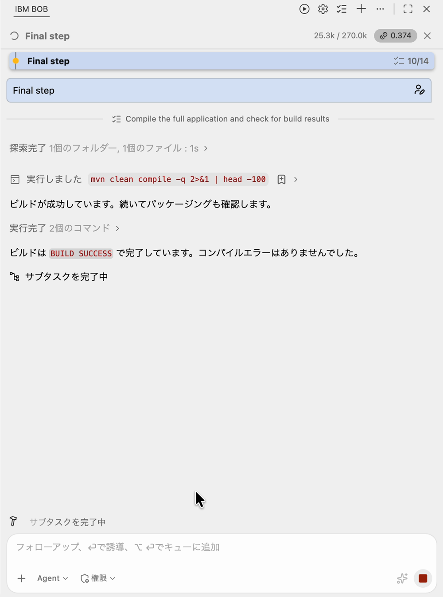
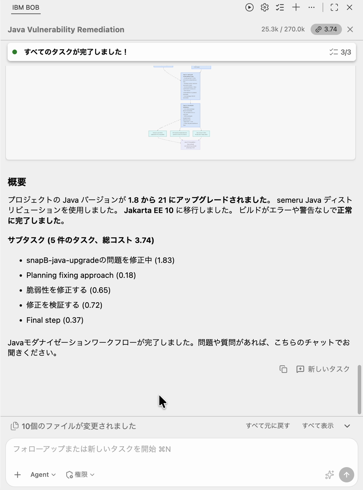

# Lab 2 — Java 21 へのアップグレード

## Simple Pharmacy Dashboard：Java 8 から Java 21 へのアップグレード

---

## 目次

1. [はじめに](#1-はじめに)
2. [前提条件](#2-前提条件)
3. [V2 の注目機能](#3-v2-の注目機能)
4. [Java Modernization ワークフローの概要](#4-java-modernization-ワークフローの概要)
5. [セットアップ](#5-セットアップ)
6. [演習 1：Java Upgrade ワークフローを実行する](#6-演習-1java-upgrade-ワークフローを実行する)
7. [演習 2：アップグレードを確認する](#7-演習-2アップグレードを確認する)
8. [トラブルシューティング](#8-トラブルシューティング)
9. [まとめ](#9-まとめ)

---

## 1. はじめに

### 対象アプリケーション

**Simple Pharmacy Management System** は、薬局業務を管理する Web アプリケーションです。

- **処方箋（Prescriptions）**: 患者の処方箋を作成・管理
- **注文（Orders）**: 薬品注文の処理・決済
- **薬品（Medicines）**: 在庫管理
- **ダッシュボード（Dashboard）**: 未処理の処方箋・注文を一覧表示

### Java バージョンアップグレードとは

Java 8 などの古い LTS バージョンから Java 21 などの最新 LTS バージョンへのアップグレードでは、主に以下の作業が発生します。

- **名前空間の変更**: `javax.*`（Java EE）から `jakarta.*`（Jakarta EE）へ
- **API の変更**: 削除・非推奨になった API の代替への移行（例：SecurityManager、sun.misc.Unsafe）
- **依存ライブラリのアップグレード**: 古い Java バージョンに固定されているライブラリの更新
- **ビルド・設定の更新**: `pom.xml`、コンパイラプラグインのバージョン、Jakarta EE ターゲットの更新

### このラボについて

**Bob V2 の Java Modernization ワークフロー**の **Java Upgrade** サブタイプを使い、薬局アプリを Java 8 から Java 21 と Jakarta EE 10 に移行します。

| 項目 | 内容 |
|------|------|
| **移行前** | Liberty ランタイム、Java 8、Struts 2.5.x |
| **移行後** | Liberty ランタイム、Java 21、Struts 2.5.x、Jakarta EE 10 |

### 学習目標

このラボを完了すると、次のことができるようになります。

- ターゲットディストリビューション・Java バージョン・Jakarta EE バージョンを設定して Java Upgrade ワークフローを構成できる
- ワークフロー途中の CVE スキャンと修正プロンプトを確認できる
- 依存関係管理変更のインタラクティブな承認フローを理解できる
- Bob のビジュアルなモダナイゼーションサマリーとタスクごとのコスト内訳を確認できる

---

## 2. 前提条件

### IBM Bob IDE（V2）

- 最新の Bob V2 IDE 拡張機能をインストール済みであること
- Java Modernization ワークフローが含まれる Premium パッケージのサブスクリプションが必要
- Bob にログインしていること

### SDKMAN!（SDK マネージャー）

```bash
curl -s "https://get.sdkman.io" | bash
echo '[[ -s "$HOME/.sdkman/bin/sdkman-init.sh" ]] && source "$HOME/.sdkman/bin/sdkman-init.sh"' >> ~/.zshrc
source ~/.zshrc
sdk version  # SDKMAN! 5.x.x と表示されることを確認
```

### Java 8（開始状態のコンパイル用）

Java 8 は開始状態のアプリケーションをクリーンにコンパイルするために必要です。Java 21 は Java Upgrade ワークフローが自動でインストールするため、手動でインストールする必要はありません。

!!! warning "Apple Silicon（M シリーズ）をお使いの方へ"
    Temurin 8 は Apple Silicon では利用できません。**Zulu ディストリビューション**を使用してください。

**動作確認済み（Apple Silicon）**: `8.0.492-zulu`

```bash
sdk install java 8.0.492-zulu
sdk use java 8.0.492-zulu   # このシェルセッションのみ有効
java -version  # 1.8 と表示されることを確認
```

!!! note
    `sdk default` ではなく `sdk use` を使用してください。このシェルセッションのみ Java 8 が有効になります。ワークフロー実行後、Bob が Java 21 をデフォルトに設定します。

### Maven

```bash
sdk install maven
mvn --version
```

### Bob の再起動

!!! warning "重要な手順"
    Maven を SDKMAN! でインストールした後は、**Bob（IDE ごと）を完全に終了して再起動**してください。

---

## 3. V2 の注目機能

このラボで注目すべき Bob V2 の新機能です。

| 機能 | 説明 |
|------|------|
| **アップグレード設定画面（構造化）** | Java ディストリビューション、ターゲット Java バージョン、Jakarta EE バージョンのドロップダウンが追加（V2 新機能） |
| **Java の自動インストール** | ワークフローが SDKMAN! 経由でターゲット Java（Semeru 21）を自動インストール |
| **ワークフロー途中の CVE スキャン** | アップグレードレシピ適用後、すべての依存関係の CVE をスキャンして、「すべて解決する／一部を選択する／いいえ」で修正を促す |
| **インタラクティブな承認フロー** | 重要な `pom.xml` の変更を適用前に理由とともに提案 |
| **タスクごとのコスト内訳 + ビジュアルサマリー** | ワークフロー終了時に詳細なコスト情報とサマリーグラフィックを表示 |

---

## 4. Java Modernization ワークフローの概要

IBM Bob の Java Modernization ワークフローは、3 つのフェーズで構成されています。

```
Analyze（分析）
 └─ プロジェクトを分析し、モダナイゼーションタイプを選択
        │
        ▼
Upgrade（アップグレード）
 └─ 選択したタイプに応じて、Issue を 1 件ずつ承認しながら自律的にアップグレード
        │
        ▼
Validate（検証）
 └─ アプリをビルドして動作確認し、モダナイゼーションサマリーを生成
```

### Bob の権限設定

チャットウィンドウの権限セレクターで操作を制御できます。

| 権限 | 内容 |
|------|------|
| **Read** | ファイルの読み取りを自動実行 |
| **Edit** | ファイルの編集を自動実行 |
| **Execute** | コマンドの実行を自動実行 |
| **MCP** | MCP の機能を自動実行 |

!!! tip "初めての方へ"
    最初は **Read のみ**を有効にして操作に慣れてから、徐々に権限を広げることをお勧めします。

---

## 5. セットアップ

### 0. スナップショットを取得する

Bob に以下をお願いしてください。

> 以下の URL から Lab 2 用のスナップショットをダウンロードして展開してください。
>
> `https://raw.githubusercontent.com/r-nakayamasan/bob-workshop-draft/main/snapshots/snapB-java-upgrade.zip`
>
> ダウンロードして `~/lab-workspace/` に展開してください。

Bob が自動で以下のコマンドを実行します（Mac/Windows どちらでも動作します）：

```bash
# ダウンロード
curl -L -o snapB.zip "https://raw.githubusercontent.com/r-nakayamasan/bob-workshop-draft/main/snapshots/snapB-java-upgrade.zip"

# 展開
python -m zipfile -e snapB.zip ./lab-workspace/
```

!!! tip "作業フォルダの場所"
    展開先は任意の場所で構いません。`~/lab-workspace/` の部分はお好みのパスに変更してください。

### 1. スナップショットフォルダを IDE で開く

展開した **`snapB-java-upgrade/`** フォルダをプロジェクトルートとして開いてください。

メニューバーから開く場合: **File > Open Folder > `snapB-java-upgrade/` に移動して Open**

!!! warning "注意"
    `snapB-java-upgrade` フォルダをそのままルートとして開いてください（親フォルダ階層ではありません）。

### 2. Agent モードを確認する

Bob のチャットパネル下部のモードインジケーターが **Agent** になっていることを確認します。

### 3. ワークフローが表示されることを確認する

Bob のチャットウィンドウ上部の再生ボタン（▶）をクリックして **Workflows** タブを開き、**Java Modernization** が一覧に表示されていることを確認します。

---

## 6. 演習 1：Java Upgrade ワークフローを実行する

### 目的

Bob の Java Modernization ワークフローを使い、薬局アプリを Java 8 から Java 21 に移行し、Jakarta EE 10 へ対応させ、セキュリティ脆弱性を修正します。

### 手順

ワークフロー実行中は、チャット上部に現在のタスクと進捗（`2/14` のようなチェックリスト）が表示されます。Bob が自律的に進める部分と、**人が判断する部分**（設定の入力、コマンドや変更の承認）が交互に現れるので、画面下部の「承認待ち」や選択肢を見逃さないようにしてください。

!!! note "画面の見た目について"
    このページのスクリーンショットは日本語 UI の Bob V2 で撮影したものです。プロジェクトのパスやコスト、検出される脆弱性の件数などは、お使いの環境により多少異なります。

#### ステップ 1：ワークフローを開始する

チャットウィンドウ上部の再生ボタン（▶）で **Bob ワークフロー** 一覧を開き、**Java Modernization** カードの **開始（Start）** をクリックします。



Java Modernization カードを展開すると、選べるサブタイプ（Java Upgrade / Liberty Modernization / UI Modernization）の説明が表示されます。このラボでは **Java Upgrade** を使います。一覧にある Java Vulnerability Remediation は単体でも起動できるワークフローですが、Java Upgrade の途中で脆弱性の修正に進むと、Bob がサブタスクとして自動で呼び出します（ステップ 6）。

---

#### ステップ 2：Analyze — プロジェクトを分析する

最初のフェーズ **Analyze** では、Bob が「どのプロジェクトを、どのようにビルドするか」を把握します。**プロジェクトを分析する** パネルが表示されたら、次のとおり確認します。

- **プロジェクトを選択**: 現在開いているプロジェクト（`snapB-java-upgrade`）のパスが自動で選ばれていることを確認します
- **カスタムプロジェクトパス** / **カスタムビルドコマンド**: どちらもオフのままにします
- **続行（Continue）** をクリックします



続行すると、Bob は裏側で次の処理を順に行います。パネルの下に進捗が表示されるので、完了するまで待ちます。

1. Java 環境の読み込み（インストール済みの JDK / Maven の確認）
2. 依存関係の検出
3. 依存関係に対する脆弱性の照会
4. **初回ビルド**の実行

!!! note "初回ビルドが成功することが前提です"
    初回ビルドは「アップグレード前の状態が正しくビルドできるか」を確かめるためのものです。これが失敗する場合は、[前提条件](#2-前提条件)の Java 8 と Maven の設定を見直してください。成功すると「初回ビルド中にエラーは見つかりませんでした」と表示されます。

---

#### ステップ 3：Analyze — モダナイゼーションタイプを選択する

初回ビルドが終わると、**モダナイゼーションの種類** の選択パネルが表示されます。ここで「何を目的に Java コードを変えるのか」を Bob に伝えます。

| 設定 | 値 |
|------|-----|
| **モダナイゼーションの種類** | Java Upgrade |
| **Git Flow を有効にする** | 無効（トグルをオフ） |

**続行** をクリックします。



- **Java Upgrade**: Java のバージョンを新しいものに上げます（このラボ）
- **UI Modernization / Java Unit Testing**: UI の刷新やユニットテスト生成用のタイプです（このラボでは使いません）
- **Liberty Modernization**: すでに Liberty を使っているアプリでは選択できません（グレーアウト表示）

!!! warning "Git Flow はオフにします"
    **Git Flow を有効にする** は、初期状態ではオンで、`java-modernization-<日時>` という名前のブランチが提案されます。オンのままだと主要なステップごとに新しいブランチへ自動コミットされます。このラボでは差分をそのまま確認できるよう、トグルを**オフ**にしてから続行してください。

---

#### ステップ 4：Upgrade — Java Upgrade の設定 ⭐ V2 新機能

2 つ目のフェーズ **Upgrade** の最初に、Bob が **Java アップグレードの設定** パネルを表示します。V2 ではアップグレード先をドロップダウンで指定できます。

| 設定 | 値 |
|------|-----|
| **Java ディストリビューション** | Semeru (IBM) |
| **Java バージョン** | Java 21 |
| **Jakarta EE バージョン** | Jakarta EE 10 |



3 つを選ぶと、パネル下部に Bob の見立てが表示されます。実行前に目を通しておきましょう。

- **説明**: 今回のアップグレードで行われる内容（`javax.*` から `jakarta.*` への名前空間移行、Struts2 6.8.0 以上への更新、Jakarta Servlet 6.0 / Pages 3.1 / JSTL 3.0 への対応、Liberty の `jakartaee-10.0` への更新など）
- **主な技術的課題**: 作業の難易度（このアプリは **複雑さ：Very High**）と、その理由（名前空間移行、Java 21 のモジュール / リフレクション制限、SecurityManager の削除、JSP のタグ構文変更など）
- **脆弱性の評価**: Java 21 へのアップグレードだけで解消できる可能性がある脆弱性の件数（スクリーンショットでは 11 件）

!!! tip "Jakarta EE バージョンの選択肢"
    ドロップダウンには「アップグレードしない」「Jakarta EE 8 / 9 / 10 / 11」が並びます。このラボでは **Jakarta EE 10** を選びます。

設定が済んだら、画面の表示に従って次に進みます。

- **Java 21 が未インストールの場合**: 続行ボタンの下に **「Java 21をインストールする」** ボタンが表示されます。クリックすると Bob が SDKMAN! 経由で Java 21（Semeru）をインストールします（1〜2 分程度）。インストールが完了すると、ワークフローが自動的に **Rewrite レシピを実行する** ステップへ進みます
- **すでにインストール済みの場合**: **続行** をクリックします

!!! note "インストールされた Java 21 はシステムのデフォルトになります"
    パネルにも「インストールされたバージョンがシステムのデフォルト Java バージョンになります」と表示されます。ワークフロー終了後に新しいターミナルを開くと、Java 21 が使われます。

Rewrite レシピの実行ステップでは、Bob が 2 つの **OpenRewrite レシピ** を適用します。OpenRewrite は、定型的なコード変換（`javax.*` → `jakarta.*` のインポート置換や、依存ライブラリ・ビルド設定の更新など）をルールベースで一括して行うツールです。AI が 1 行ずつ書き換えるのではなく、まず確実に変換できる部分をレシピで機械的に処理し、残ったビルドエラーを次のステップで Bob が修正します。

---

#### ステップ 5：Upgrade — 依存関係変更の承認 ⭐ V2 新機能

レシピの適用後に Bob がビルドすると、コードベースに残った Issue が見つかります。Bob はその Issue ごとに **サブタスク**（「〜の問題を修正中」）を起動し、原因を調べ、修正案を示して**承認を求めます**。

このラボのアプリでは、**`javassist 3.20.0-GA` の依存関係警告** が出ることが想定されます（実際には異なる場合があります）。

**① 調査コマンドの承認**

Bob はまず、`javassist` が `pom.xml` に直接書かれているのか、他のライブラリ経由で入ってきているのかを `mvn dependency:tree` などで調べます。コマンドを実行する前に、画面下部に **承認待ちのツール** が表示されます。



| ボタン | 動作 |
|--------|------|
| **一度だけ承認** | このコマンドだけ実行を許可します |
| **拒否** | このコマンドを実行させません |
| **タスクに対して承認** | このサブタスクの間は、同種のコマンドを確認なしで許可します |

内容が読み取り専用の調査コマンドであることを確認し、**一度だけ承認** をクリックします。

!!! tip "「コマンドが失敗しました」と表示されても慌てない"
    調査の途中でコマンドが失敗した旨が表示されることがありますが、Bob はその結果を踏まえて別の方法で調査を続けます。

**② `pom.xml` 変更の承認**

調査の結果、`javassist` は `struts2-core → ognl → javassist` という**推移的な依存**として入っていることがわかります。そのうえで Bob は、次のように原因と修正案を説明し、適用の可否を尋ねます。



- **問題**: `javassist:3.20.0-GA` は、Java 9 以降で削除された `tools.jar` を `systemPath` で参照しているため、Java 21 で警告が発生する
- **修正内容**: `<dependencyManagement>` に `javassist:3.30.2-GA`（Java 21 対応で `tools.jar` を参照しない）を追加し、推移的依存のバージョンを上書きする

内容を確認して **「はい、変更を適用してください」** を選びます。右側の鉛筆アイコンから、回答の文面を編集して返すこともできます。

!!! note "なぜ毎回確認するのか"
    `pom.xml` のようなビルド全体に影響するファイルの変更は、Bob が勝手に進めず、**理由とセットで提示して人が判断する**仕組みになっています。依存関係の更新では、意図しないバージョン変更を防ぐために重要な確認ポイントです。

---

#### ステップ 6：Upgrade — CVE スキャンと脆弱性の修正 ⭐ V2 新機能

Issue の修正が一段落すると、Bob は**すべての依存関係を CVE データベースに照会**します（このラボの実行例では 16 個の依存関係を照会し、**11 件の脆弱性**を検出）。そして、修正に進むかどうかを確認します。



| 選択肢 | 動作 |
|--------|------|
| **はい、すべて解決する** | 検出されたすべての脆弱性を修正対象にします |
| **はい、一部を選択する** | 修正する脆弱性を自分で選びます |
| **いいえ** | 脆弱性の修正をスキップします |

このラボでは **「はい、すべて解決する」** を選びます。

選択すると、Bob は **Java Vulnerability Remediation** をサブタスクとして起動し、「修正アプローチを計画する → 脆弱性を修正する → 修正を検証する」の順で進めます。このアプリでは主に次の変更が行われます。



- **Struts のアップグレード**: `pom.xml` の `struts2.version` を `2.5.33` から `6.8.0` に更新し、必要な推移的依存のオーバーライドを追加します
- **`struts.xml` の見直し**: 開発モード（`devMode`）を `false` に変更します

「修正を検証する」では、Bob が再びビルドと依存関係ツリーの確認（`mvn dependency:tree` など）を行い、**既知の脆弱性が残っていないか**をチェックします。ここでもコマンドの承認が求められたら、ステップ 5 と同様に内容を確認して承認してください。

---

#### ステップ 7：Validate — 最終ビルドの確認

最後のフェーズ **Validate** では、Bob が Java 21 で `mvn clean compile` を実行し、アップグレード後のコードがクリーンにビルドできることを確認します（続けてパッケージングの確認も行います）。チャットの出力に `BUILD SUCCESS` が表示されることを確認します。



これが「アップグレード前は Java 8 でビルドでき、アップグレード後は Java 21 でビルドできる」ことを確かめる最終チェックです。

---

#### ステップ 8：Validate — モダナイゼーションサマリー ⭐ V2 新機能

全サブタスクが完了すると、Bob が**ビジュアルなモダナイゼーションサマリー**を表示します。



画面上部には、実施した作業の流れを示す図（フロー図）が表示されます。その下の **概要** で、次の点を確認してください。

- ✅ Java バージョンが **1.8 → 21**（IBM Semeru ディストリビューション）にアップグレードされた
- ✅ **Jakarta EE 10** 移行が適用された
- ✅ ビルドが**エラーや警告なし**で成功した
- ✅ セキュリティ脆弱性が**解決**された

続く **サブタスク** の一覧には、**タスクごとのコスト内訳**が表示されます。この例では 5 件のタスクで総コスト 3.74 でした（問題の修正 1.83、修正方針の計画 0.18、脆弱性の修正 0.65、修正の検証 0.72、最終ステップ 0.37）。このラボの実際のコストは通常 3〜5 Bob コイン程度です。どの工程にどれだけ使われたかがわかるので、実際のプロジェクトで試すときの見積もりの参考になります。

画面下部の **「10個のファイルが変更されました」** は、このワークフローで Bob が変更したファイルの数です。**すべて表示** で変更内容の一覧を開けます（次の演習 2 で確認します）。

---

## 7. 演習 2：アップグレードを確認する

### diff の確認

Bob が行った名前空間の変更はこのラボの重要な学習ポイントです。`src/main/java/com/pharmacy/action/` 以下の変更されたファイルをいくつか開き、以下を確認してください。

- `javax.*` → `jakarta.*` のインポート置換

### コンパイル確認

Bob のターミナルで Java 21 が有効になっていることを確認します。

```bash
java -version  # 21 と表示されることを確認
mvn clean compile
# BUILD SUCCESS が表示されることを確認
```

### アプリケーションの起動

Bob のチャットで以下のように入力して起動コマンドを教えてもらいます。

```
このアプリケーションを起動するコマンドを教えてください。
```

起動後、以下の URL で動作を確認します。

```
http://localhost:9081/simple-pharmacy/dashboard
```

!!! tip
    アプリケーション起動時にエラーが発生した場合は、出力をそのまま Bob チャットに貼り付けてデバッグしてもらいましょう。

---

## 8. トラブルシューティング

### Maven インストール後にコマンドが見つからない

**症状**: `mvn: command not found`

**対処法**:

1. SDKMAN! のインストールを確認: `sdk version`
2. Maven を再インストール: `sdk install maven`
3. Bob を完全に終了して再起動
4. 新しいターミナルで確認: `mvn --version`

---

### ワークフロー後も Bob のターミナルで Java 8 が表示される

**症状**: ワークフロー完了後、Bob のターミナルで `java -version` が `1.8` を表示する

**対処法**: ワークフローがインストールした Java 21 が SDKMAN のデフォルトになります。新しいターミナルを開くか、`sdk use java 21.0.11-semeru` を実行してください。

---

### Bob がプロジェクトファイルを読み取れない

**症状**: 「そのファイルにアクセスできません」または「ファイルが見つかりません」

**対処法**:

1. `snapB-java-upgrade` サブフォルダをプロジェクトルートとして開いているか確認
2. ファイルのパーミッションを確認: `ls -la`
3. `@ファイル名` 構文でファイルを参照してみる

---

### レシピ適用後のビルドエラー

**症状**: OpenRewrite レシピ適用後にコンパイルエラーが発生する

**対処法**: Bob がこれらのエラーを自動的に修正するサブタスクを開始します。チャットでサブタスクの進行状況を確認してください。サブタスク完了後もエラーが残る場合は、完全なエラー出力を Bob に共有して調査を依頼してください。

---

### javax と jakarta の混乱

**症状**: `javax.servlet.*` などが見つからないというランタイムエラー

**対処法**: Jakarta EE 10 では `javax.*` パッケージが `jakarta.*` に置き換えられています。Bob がアップグレード時にこれを書き換えます。残存している参照がある場合は、Bob に以下のように依頼してください。

```
jakarta.* に変更すべき javax.* の参照がないか、すべてのインポートを確認してください。
```

---

## 9. まとめ

おめでとうございます！Bob V2 の Java Modernization ワークフローを使って Java Upgrade ラボを完了しました。

- ✅ 前提条件のセットアップ（SDKMAN!、Java 8 の開始状態、Maven）
- ✅ Java Upgrade ワークフローの設定（ディストリビューション、バージョン、Jakarta EE）
- ✅ OpenRewrite レシピの適用とビルドエラーの自律的な修正
- ✅ インタラクティブなフローを通じた依存関係変更の承認
- ✅ ワークフロー途中の CVE スキャンと脆弱性修正への対応
- ✅ 最終的なモダナイゼーションサマリーの確認とアプリケーションの動作確認

次は **[Lab 3 — UI のモダナイゼーション](java_premium_lab3.md)** に進みましょう。
