# Lab 3 — UI のモダナイゼーション

## Simple Pharmacy：レガシー UI のモダナイゼーション

---

## 目次

1. [はじめに](#1-はじめに)
2. [前提条件](#2-前提条件)
3. [Java Modernization ワークフローの開始](#3-java-modernization-ワークフローの開始)
4. [ワークフローのステップバイステップ](#4-ワークフローのステップバイステップ)
5. [トラブルシューティング](#5-トラブルシューティング)
6. [まとめ](#6-まとめ)

---

## 1. はじめに

### Java Modernization ワークフローとは

Java Modernization ワークフローは、IBM Bob の中で Java アプリケーションを段階的にモダナイズするための、AI アシスト型のガイドプロセスです。ワークフローには次の 3 つの種類があります。

| 種類 | 内容 |
|------|------|
| **Java Upgrade** | プロジェクトの Java バージョンを最新バージョンへアップグレードする |
| **Liberty Modernization** | Java アプリケーションを WebSphere Liberty を使うように最新化する（AMA ZIP ファイルが必要） |
| **UI Modernization** | JSP、JSF、Struts で作られた UI を、Java バックエンドとモダンなフロントエンド（React）の 2 つのアプリケーションに変換する |

このラボでは **UI Modernization** を使い、`snapC-ui-mod`（Struts/JSP でサーバーサイドレンダリングされた Simple Pharmacy）を変換します。

### ワークフローの進行

Bob は次の順番で作業を進めます。

1. **アーキテクチャ分析**: 既存コードを調べ、`architecture.md`、`architecture-diagram.mmd`、`ui-modernization-options.json` の 3 つのドキュメントを作成
2. **プロジェクト設定**: フロントエンド（React + Material UI）とバックエンド（Jakarta EE style Rest Services）を選択
3. **バックエンド移行**: Struts を外し、Liberty で動く REST API にする
4. **フロントエンド構築**: React の画面を作り、ブラウザーで確認しながら修正する
5. **検証**: 両方のアプリケーションを起動して動作を確認し、アーキテクチャ図とサマリーを作成する

### このラボについて

| 項目 | 内容 |
|------|------|
| **開始状態** | Struts/JSP によるサーバーサイドレンダリング |
| **目標状態** | React + Material UI のフロントエンドと、Jakarta EE style REST バックエンド |
| **対象アプリケーション** | `snapC-ui-mod`（Simple Pharmacy） |

### 学習目標

このラボを完了すると、次のことができるようになります。

- Java Modernization ワークフローを開始し、UI Modernization を選択できる
- Bob が作成したアーキテクチャのドキュメントを確認できる
- 設定フォームでフロントエンドとバックエンドのスタックを指定できる
- 起動したアプリケーションを Swagger UI とブラウザーで確認し、結果を Bob に伝えてデバッグできる

---

## 2. 前提条件

### IBM Bob IDE

- 最新バージョンの IBM Bob をインストール済みで、ログインしていること
- **Agent モード**へのアクセスがあること（ワークフロー開始に必要）

### Java と Maven

Liberty バックエンドのビルドと起動に必要です。

```bash
java -version   # Java 17 以上
mvn -version    # Maven 3.x
```

### Node.js と npm

フロントエンドの `npm run dev` に必要です。

```bash
node -v   # Node.js
npm -v    # npm
```

### 追加ツール

ワークフローが推奨するターゲット状態によって、追加のツールやランタイムが必要になる場合があります。Bob が選択したオプションに必要なツールを示した場合は、インストールしてください。

---

## 3. Java Modernization ワークフローの開始

### 0. スナップショットを取得する

Bob に以下をお願いしてください。

> 以下の URL から Lab 3 用のスナップショットをダウンロードして展開してください。
>
> `https://raw.githubusercontent.com/r-nakayamasan/bob-workshop-draft/main/snapshots/snapC-ui-mod.zip`
>
> ダウンロードして `~/lab-workspace/` に展開してください。

Bob が自動で以下のコマンドを実行します（Mac/Windows どちらでも動作します）。

```bash
# ダウンロード
curl -L -o snapC.zip "https://raw.githubusercontent.com/r-nakayamasan/bob-workshop-draft/main/snapshots/snapC-ui-mod.zip"

# 展開
python -m zipfile -e snapC.zip ./lab-workspace/
```

!!! tip "作業フォルダの場所"
    展開先は任意の場所で構いません。`~/lab-workspace/` の部分はお好みのパスに変更してください。

### ワークスペースを開く

1. 展開した **`snapC-ui-mod/`** フォルダを Bob のアクティブなワークスペースとして開く
2. Bob チャットインターフェースを開く

### Agent モードに切り替える

Java Modernization ワークフローは Bob の **Agent モード**で実行されます。Agent モードでは以下が可能です。

- 複数ファイルの読み書き操作
- 複雑なマルチステップのワークフロー実行
- レガシー Java UI パターンとモダン UI モダナイゼーションに関する深い知識の活用

**Agent モードへの切り替え**:

1. Bob チャットウィンドウ下部のモードインジケーターをクリック
2. ドロップダウンから **Agent** を選択

### ワークフローを開始する

1. 設定ギアの近くにある再生ボタン `(▶︎)` をクリックして、ワークフローの一覧を開く
2. **Java Modernization** のカードを展開すると、3 つの種類（Java Upgrade、Liberty Modernization、UI Modernization）の説明が表示される
3. **開始** をクリックする

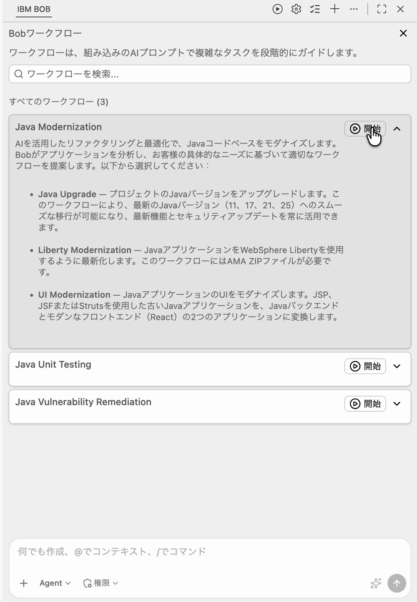

または、Bob チャットウィンドウで以下のように入力してもワークフローを開始できます。

```
この Java アプリケーションの UI をモダナイズしたいです。Java Modernization ワークフローの UI Modernization を実行してください。
```

Bob が Java Modernization ワークフローを開始し、プロジェクトの分析から進みます。

---

## 4. ワークフローのステップバイステップ

### ステップ 1：プロジェクトを分析する

Bob が **プロジェクトを選択** の欄に、開いているプロジェクトのパスを自動で入力します。**カスタムプロジェクトパス**と**カスタムビルドコマンド**のトグルはオフのままにして、**続行** をクリックします。

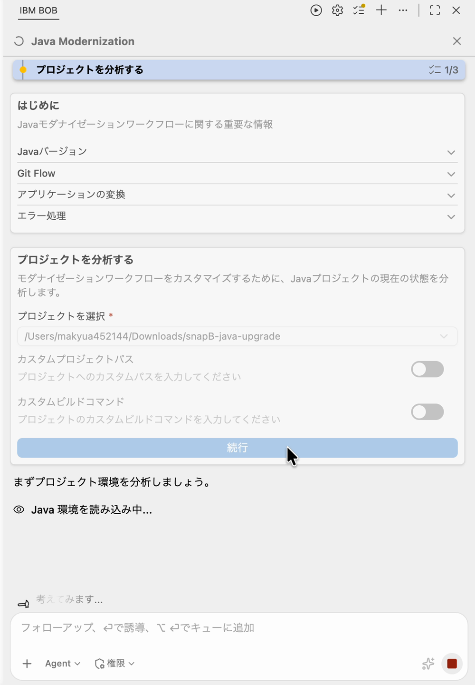

続行すると、Bob は次の順番で準備を進めます。

- Java 環境を読み込む
- 依存関係を検出する
- 脆弱性の照会を行う
- 初回ビルドを実行して、プロジェクトに問題がないか確認する（画面には「プロジェクトをビルド中…」と表示されます）

!!! note
    収録時は `snapB-java-upgrade` フォルダーを使っているため、画面のパスも `snapB-java-upgrade` になっています。このラボでは展開した `snapC-ui-mod` を選択してください。

---

### ステップ 2：UI Modernization を選択する

**フロー選択** の画面で、モダナイゼーションの種類を選びます。

- **UI Modernization** を選択する
- **Liberty Modernization** はグレー表示になり、選択できません。画面には「アプリケーションはすでに Liberty を使用しています」と表示されます。
- **Git Flow を有効にする** はオンのままにします。オンにすると、Bob が **作成するブランチ名**（例: `java-modernization-20261027145101`）のブランチを作成し、主要なステップごとに変更を自動でコミットします。

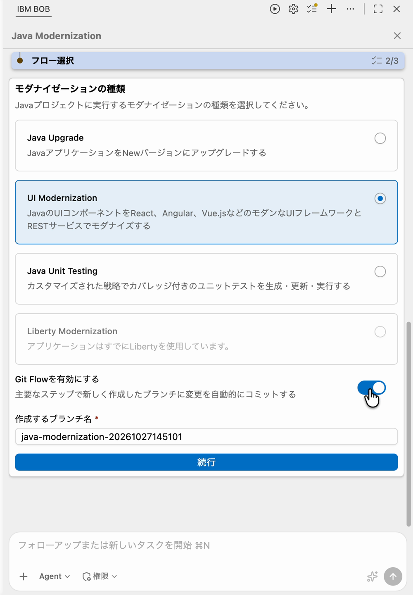

!!! note
    動画の収録では Git Flow がオンの状態で進めています。ブランチを作りたくない場合は、トグルをオフにしてから **続行** をクリックしてください。

**続行** をクリックします。

---

### ステップ 3：アーキテクチャを分析する

続行すると、Bob がサブタスク **アプリケーションアーキテクチャを分析する** を開始します。Bob は既存のソースを読み、次の 3 つのファイルを作成します。

| ファイル | 内容 |
|------|------|
| `architecture.md` | 既存アプリケーションのアーキテクチャの説明 |
| `architecture-diagram.mmd` | アーキテクチャ図（Mermaid 形式） |
| `ui-modernization-options.json` | UI モダナイゼーションのオプション |

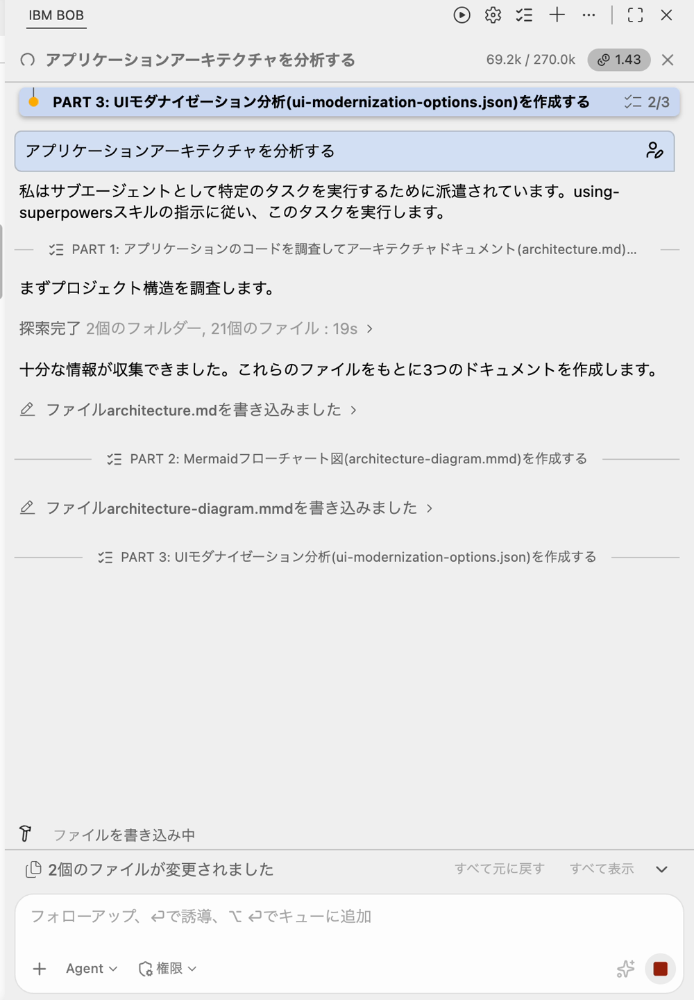

動画の収録では、約 19 秒でプロジェクト構造（2 フォルダー、21 ファイル）を調べ終えています。ドキュメントの作成が完了するまで待ちましょう。

---

### ステップ 4：UI モダナイゼーションプロジェクトを設定する

分析が終わると、**UI モダナイゼーションプロジェクトを設定する** のフォームが表示されます。次の表の値を入力します。

| 項目 | 設定値 |
|------|-----|
| **フロントエンドのモダナイゼーション** | オン |
| **バックエンドのモダナイゼーション** | オン |
| **フロントエンドフレームワーク** | `React`（候補: React / Vue.js / Angular） |
| **フロントエンドデザインシステム** | `Material UI` |
| **フロントエンドプロジェクトパス** | `src/main/webapp`（**ディレクトリを選択** で指定） |
| **バックエンドフレームワーク** | `Jakarta EE style Rest Services` |
| **バックエンドプロジェクトパス** | `src/main/java/com`（**ディレクトリを選択** で指定） |

フロントエンドフレームワークの候補はドロップダウンに表示されます。

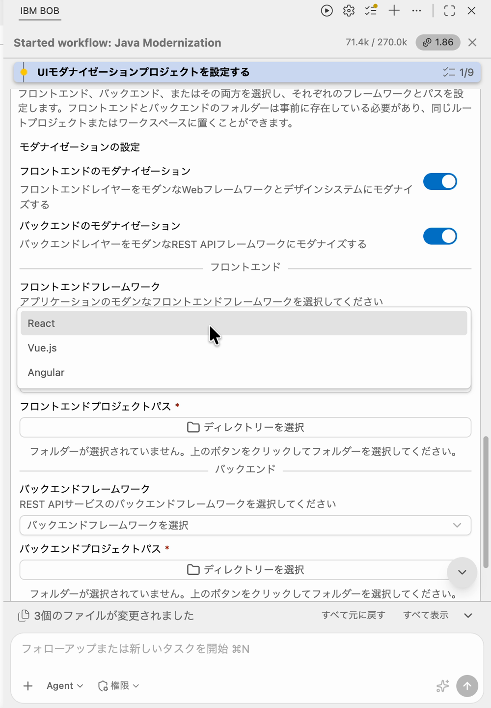

**ディレクトリを選択** をクリックすると、フォルダー選択ダイアログが開きます。フォルダーを選ぶと「1 選択済み」と表示されます。

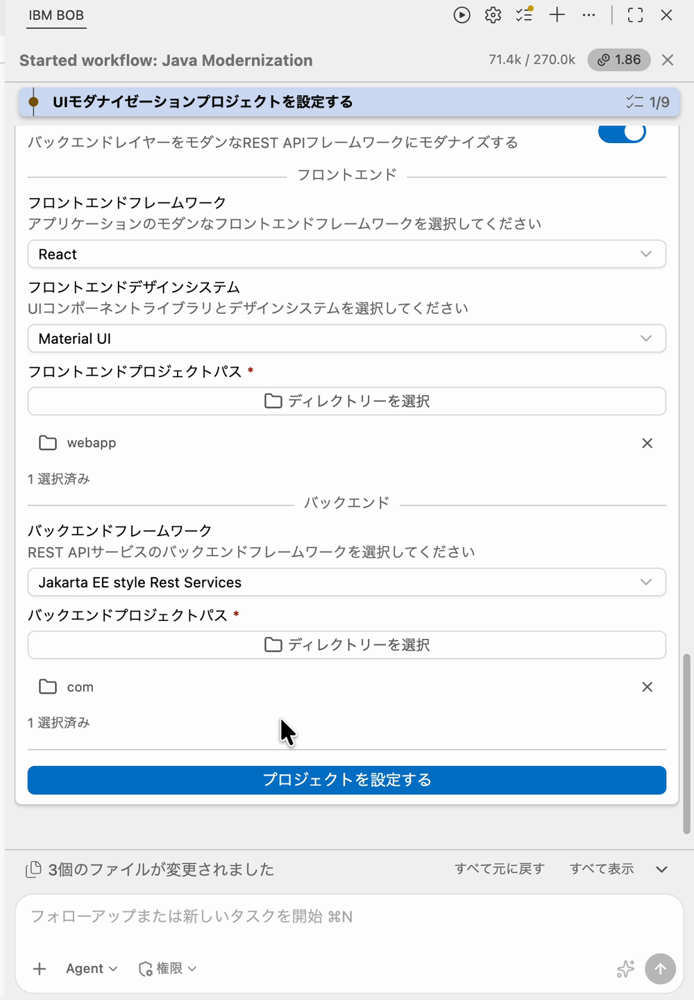

設定が終わったら **プロジェクトを設定する** をクリックします。

---

### ステップ 5：バックエンドを Jakarta EE の REST API に移行する

**Backend Migration** のサブタスクが始まります。Bob は To-Do リストを作成し、既存の Model と Repository はそのまま使って、REST API を追加します。

- 既存の `src/main/java/com` に REST リソースを追加する（バックエンドのパスは変えない）
- Struts の依存関係を削除し、Jakarta EE REST（JAX-RS）と MicroProfile OpenAPI に置き換える
- `pom.xml` を Liberty Maven Plugin と Jakarta EE REST 用に更新する
- `server.xml` に `restfulWS-3.1` の機能を追加する

Bob は古い Struts の `action` パッケージも削除します。古い Action クラスは `ActionSupport` に依存しているため、Struts を外すとコンパイルエラーになります。REST リソースで置き換え済みなので、`action` パッケージのクラスは不要です。

Bob は `mvn clean package -q 2>&1 | tail -50` でビルドを確認し、エラーが出ればその場で修正して、ビルドが成功するまで繰り返します。

ビルドが成功すると、Bob がアプリケーションの起動コマンドを提示します。ターミナルで実行してください。

```bash
mvn liberty:run
```

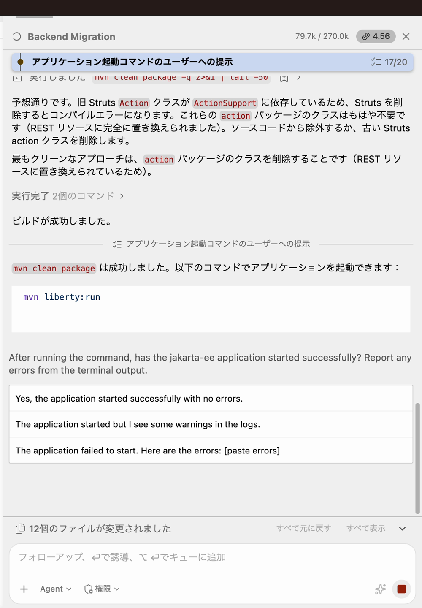

!!! note
    初回の起動は Maven ビルドを含むため、2〜3 分ほどかかります。ターミナルに `CWWKF0011I: The defaultServer server is ready to run a smarter planet.` と表示されれば起動は完了です。

起動したら、ブラウザーで次の Swagger UI を開きます。

```
http://localhost:9081/simple-pharmacy/openapi/ui
```

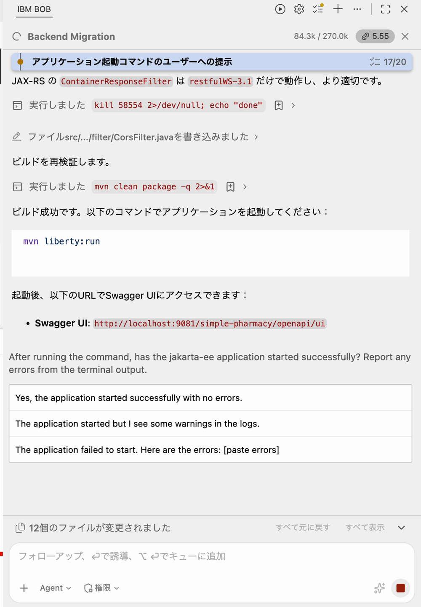

Bob が「After running the command, has the jakarta-ee application started successfully?」と質問するので、ターミナルの結果に合う選択肢を選びます。

- **Yes, the application started successfully with no errors.**
- **The application started but I see some warnings in the logs.**
- **The application failed to start. Here are the errors: [paste errors]**

起動に失敗した場合は、ターミナルのエラーを選択肢の **[paste errors]** に貼り付けて Bob に送ります。エラーの例は次のとおりです。

```
[INFO] [ERROR   ] SRVE0321E: The [struts2] filter did not load during start up.
[INFO] Filter [struts2]: Could not find required filter class - org.apache.struts2.dispatcher.filter.StrutsPrepareAndExecuteFilter.class
[INFO] [ERROR   ] SRVE0321E: The [com.pharmacy.rest.CorsFilter] filter did not load during start up.
```

---

### ステップ 6：フロントエンドをセットアップする

**Frontend Setup** のサブタスクで、Bob は次の作業を行います。

- `architecture.md` と既存の REST API を読み、アプリケーションの構成を把握する
- To-Do リストを作成し、フロントエンドのプロジェクトを `src/main/webapp` に作成する
- 依存関係をインストールし、ビルドを実行する（チャンクサイズに関する表示は MUI のバンドルサイズによるもので、エラーではありません）
- `README.md` に起動方法を書く

準備ができると、Bob が次の起動コマンドを提示します。ターミナルで実行してください。

```bash
cd <プロジェクトのパス>/src/main/webapp && npm run dev
```

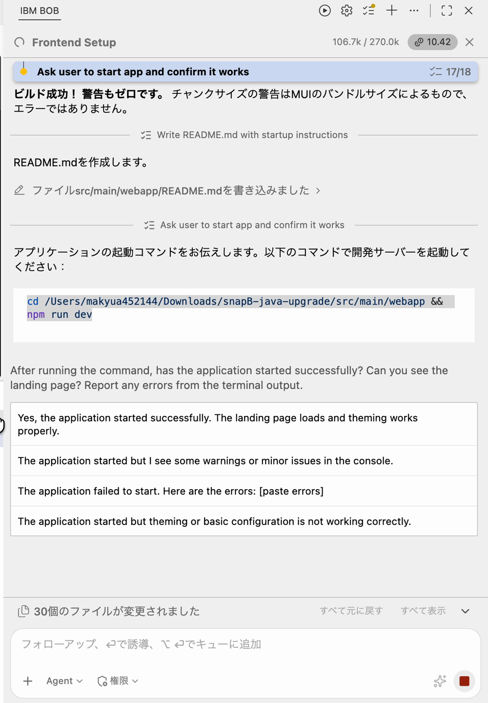

ブラウザーで **http://localhost:5173** を開きます（Vite の既定ポート）。

ホームページが表示され、テーマが反映されていれば、Bob の質問に「Yes, the application started successfully. The landing page loads and theming works properly.」を選びます。表示に問題がある場合は、その内容を選択肢に貼り付けて Bob に伝えてください。

---

### ステップ 7：コンポーネントとホームページを作る

**Frontend Components & Home Page** のサブタスクでは、Bob が共通コンポーネントと画面を作ります。動画では次のような作業が行われました。

- 共通コンポーネント（`StatusChip`、`LabelValue`）を作成する
- 処方箋フォーム用の `useFormValidation` フックを作成する
- `AppLayout` にアプリのタイトルとフッターを追加する
- `DashboardPage` にステータスの色分けチップなどを追加する

作業が完了すると「すべてのタスクが完了しました！」と表示され、動作確認の質問が出ます。

#### 404 エラーが出た場合（動画の例）

この段階で、ブラウザーの **薬品在庫管理** 画面は一覧が空のままで、Bob のチャットには `Request failed with status code 404` が表示されました。画面のエラーを Bob に伝えると、Bob はバックエンドの状態を調べます。

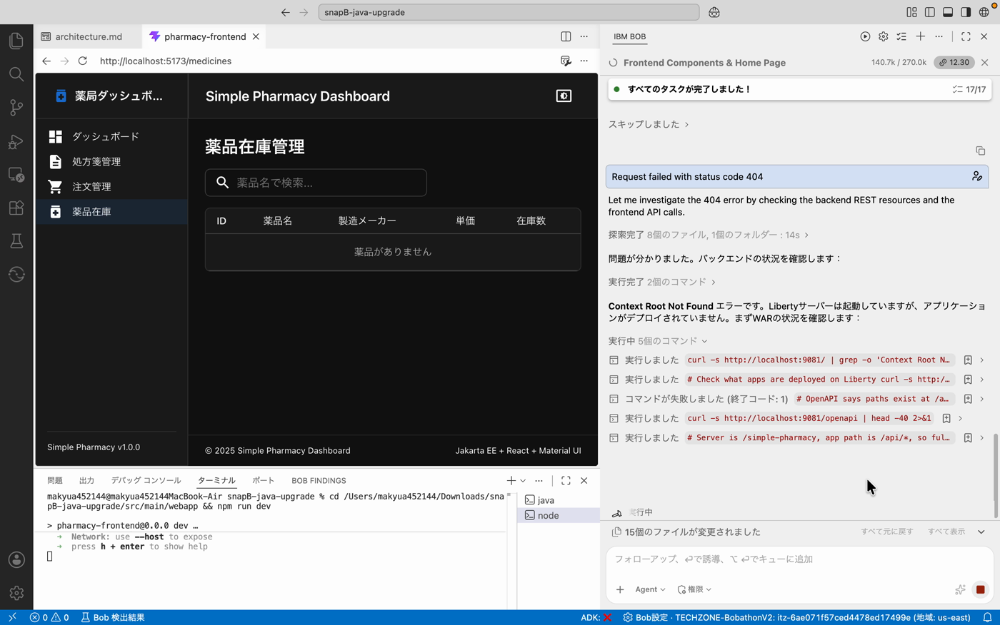

Bob は `Context Root Not Found` の原因を次のように特定し、修正しました。

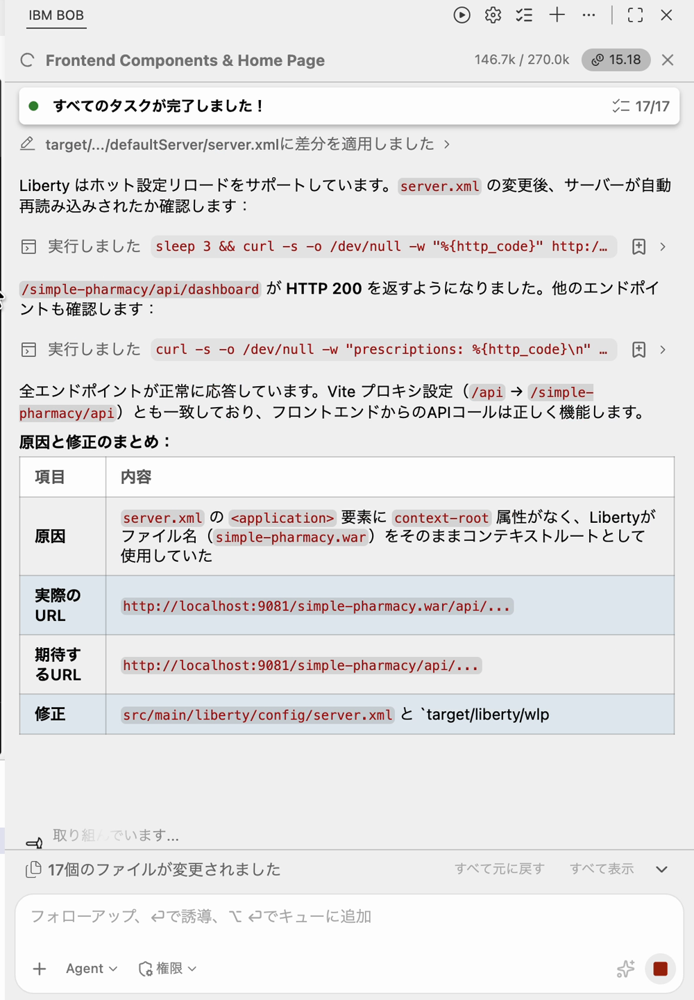

- **原因**: `server.xml` の `<application>` 要素に `context-root` 属性がなく、Liberty がファイル名の `simple-pharmacy.war` をそのままコンテキストルートとして使っていた
- **修正**: `src/main/liberty/config/server.xml` に `context-root` を設定し、`target/liberty/wlp` にも反映する
- **確認**: `http://localhost:9081/simple-pharmacy/api/dashboard` が HTTP 200 を返す。フロントエンドの `/api` のプロキシ先（`/simple-pharmacy/api`）も一致している

Liberty は `server.xml` の変更を自動で再読み込みするため、動画ではサーバーを再起動せずに確認しています。

---

### ステップ 8：ページとバックエンドの連携を確認する

**Frontend Pages & Backend Integration** のサブタスクでは、Bob が既存のページ（`PrescriptionListPage`、`DashboardPage`、`PrescriptionCreatePage`、`PrescriptionDetailPage`）を確認し、画面と API をつなぎます。`npm run build` でビルドを確認したあと、動作確認のための起動コマンドを提示します。

ブラウザーで **薬品在庫管理** の一覧に薬品データ（MED001 〜 MED008）が表示されれば、API との連携は正常です。

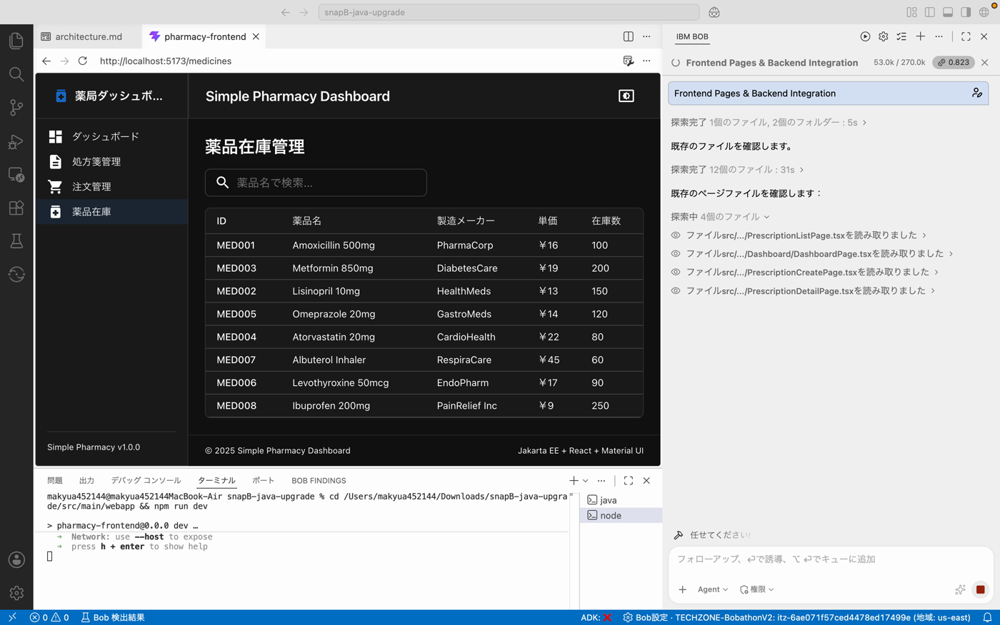

Bob の質問には、画面の状態に合う選択肢で答えます。すべてのページが動き、ナビゲーションも問題なければ「Yes, the application is working perfectly. All pages load correctly, navigation works as expected.」を選びます。

---

### ステップ 9：両方のアプリケーションを検証する

**Validation** のサブタスクで、Bob はまず README を読み、使用するポートを確認します。

- **バックエンド**（Jakarta EE / Liberty）: `9081`
- **フロントエンド**（React / Vite）: `5173`

ポートの確認では、Bob が次のコマンドを実行するため承認を求められます。

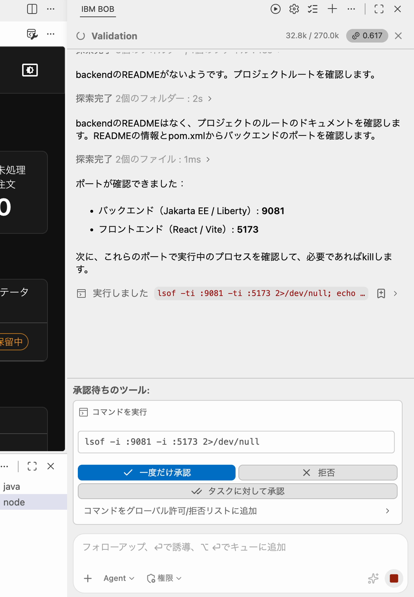

このコマンドは、指定したポートを使っているプロセスを一覧するものです。**一度だけ承認** を選ぶと、この 1 回だけ実行されます。

続いて、Bob が「Did both applications start successfully? Can you access the frontend in your browser and interact with it?」と質問します。

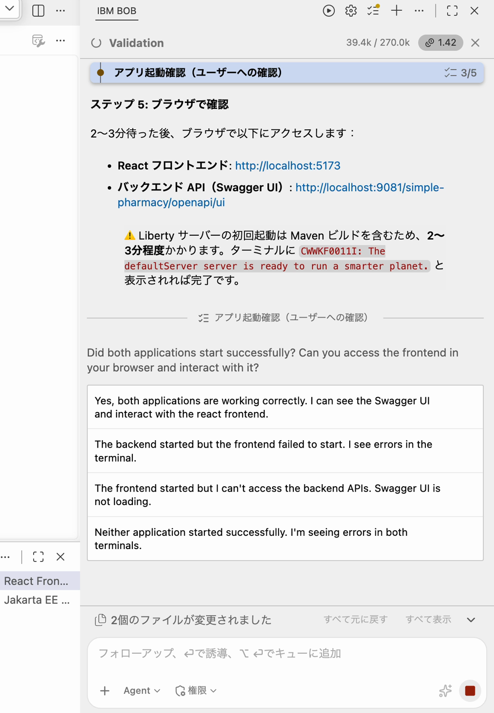

Swagger UI とフロントエンドを実際に開いて確認し、結果に合う選択肢を選びます。動作確認の最後に、ダッシュボードで処方箋の件数や在庫の情報が表示されることも確認してください。

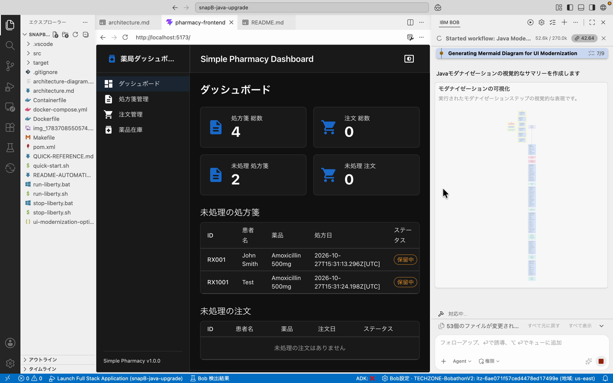

---

### ステップ 10：アーキテクチャ図とサマリーを確認する

最後に Bob が UI モダナイゼーションのアーキテクチャ図（Mermaid）を生成し、結果をサマリーにまとめます。

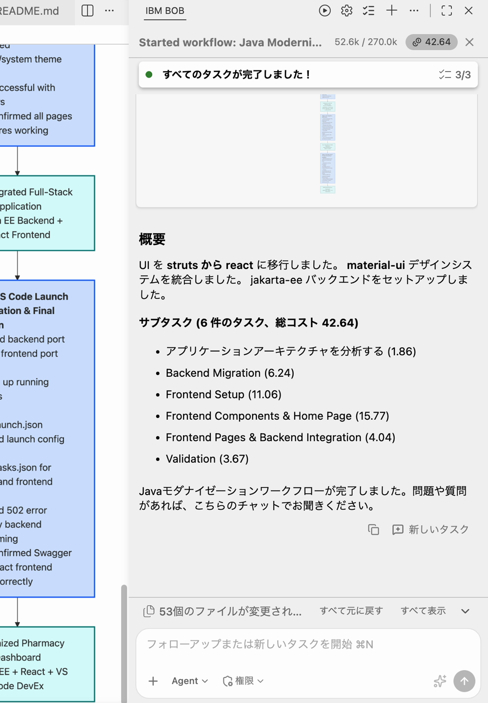

サマリーには次の内容が含まれます。

- UI を Struts から React に移行したこと
- Material UI のデザインシステムを統合したこと
- Jakarta EE バックエンドをセットアップしたこと
- サブタスクごとのコスト（実行のたびに変わります）

「Java モダナイゼーションワークフローが完了しました」と表示されたら、このラボは完了です。

---

## 5. トラブルシューティング

### Bob のターミナルで Java バージョンが期待と異なる

**症状**: Bob のターミナルで `java -version` が予期しないバージョンを表示する

**対処法**: `sdk list java` で利用可能な Java 21 の識別子を確認し、Bob のターミナルで以下を実行してください。

```bash
sdk use java <識別子>
```

`sdk use` はシェルスコープのため、ターミナルタブや Bob が独立して開くターミナルには適用されません。各シェルで個別に実行する必要があります。

---

### Liberty の起動が完了しない

**症状**: `mvn liberty:run` の後、`CWWKF0011I` が表示されない

**対処法**: 初回は Maven ビルドを含むため、2〜3 分ほどかかります。それでも完了しない場合は、ターミナルのログを Bob チャットに貼り付けてください。

---

### ブラウザーで 404 エラーが出る、一覧が空になる

**症状**: `Request failed with status code 404` が表示される、または薬品一覧が空のままになる

**対処法**: ステップ 7 の手順で Bob にエラーを伝えてください。`server.xml` の `context-root` の設定が原因の場合があります。

---

### ポートが使用中になっている

**症状**: ポート `5173`（フロントエンド）または `9081`（バックエンド）が使用中で起動できない

**対処法**: 既存のプロセスを停止してから、もう一度起動してください。使用中のプロセスは、Bob に `lsof -ti :<ポート番号>` で確認を依頼できます。

---

### バックエンドのビルドエラー

**症状**: `mvn clean package` が失敗する

**対処法**: エラーの完全な出力を Bob チャットに貼り付けてください。Bob が自律的に修正します。

---

### フロントエンドの npm エラー

**症状**: `npm run dev` でエラーが発生する

**対処法**: エラー内容を Bob チャットに貼り付けてデバッグしてもらいます。

```bash
# node_modules をクリーンインストールする場合
cd src/main/webapp
rm -rf node_modules package-lock.json
npm install
```

---

## 6. まとめ

Lab 3（Java Modernization ワークフローの UI Modernization）を Simple Pharmacy アプリケーションに適用して完了しました。

- ✅ IBM Bob で Java Modernization ワークフローを開始し、UI Modernization を選択する
- ✅ 設定フォームで React、Material UI、Jakarta EE style Rest Services を指定する
- ✅ Bob と一緒に REST バックエンドとフロントエンドを作成し、起動して確認する

### 重要なポイント

1. **Java Modernization ワークフロー**: ワークフローの種類を選ぶと、Bob が分析から検証まで段階的に進める
2. **設定フォームでスタックを決める**: フロントエンド、デザインシステム、バックエンドの値を入力して、Bob の作業範囲を決める
3. **段階的なアプローチ**: 分析 → バックエンド移行 → フロントエンド構築 → 検証の順で進み、各段階の結果を確認できる
4. **実行時のエラーは Bob と一緒にデバッグ**: 404 のようなエラーは、画面やログを Bob に貼り付けて修正してもらう
5. **インタラクティブなガイド**: 質問に答えながら進めることで、Bob が修正を繰り返して完成へ導く

### 次のステップ（オプション）

追加時間がある場合や、さらに探求したい場合：

**生成された UI の最適化**:
```
作成した React フロントエンドの UI を最適化してください。
```

**コード品質のレビュー**:
```
移行されたコードのアーキテクチャ、保守性、エラーハンドリング、コード構成、ドキュメントの完成度をレビューしてください。
```

**モダナイゼーションサマリーの作成**:
```
モダナイズされた内容、主要なアーキテクチャの変更点、既知の問題、次のステップを含む MIGRATION_SUMMARY.md を作成してください。
```

---

次は **[Lab 4 — ユニットテストの生成](java_premium_lab4.md)** に進みましょう。
