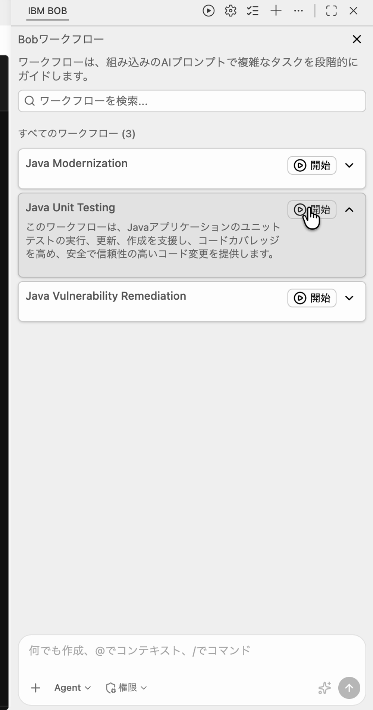
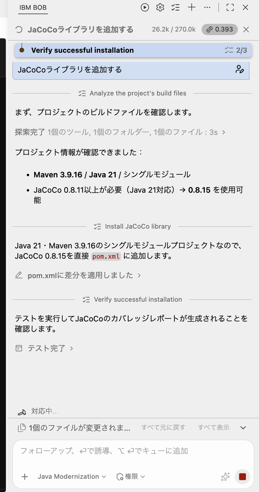
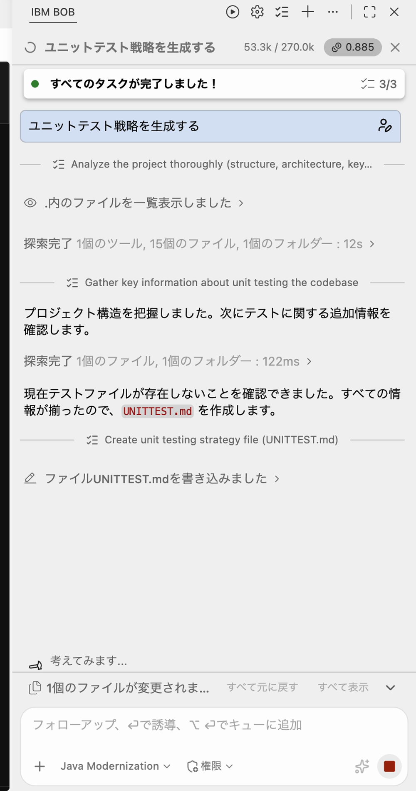
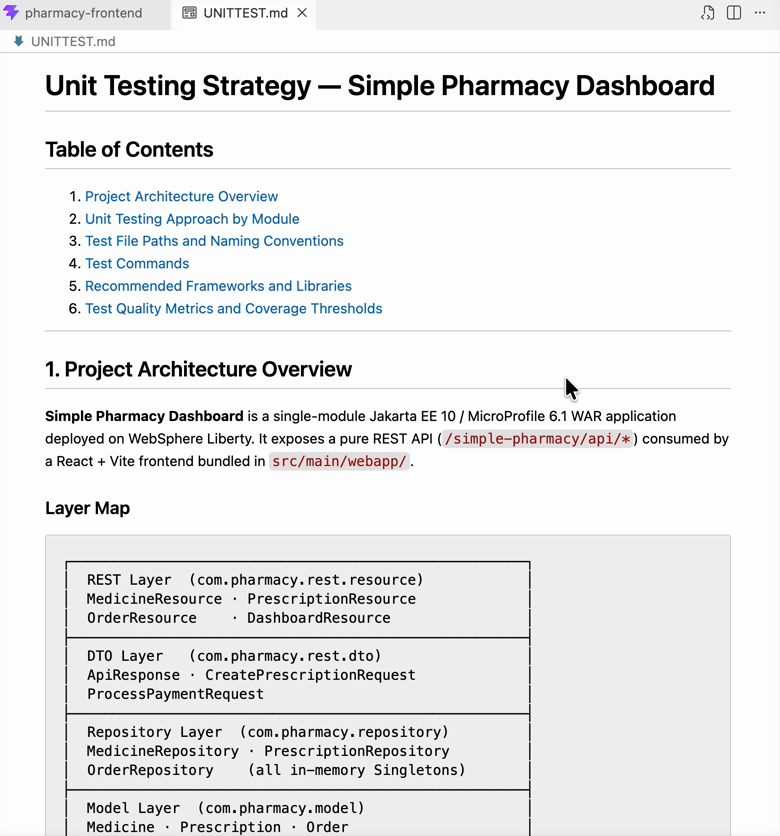
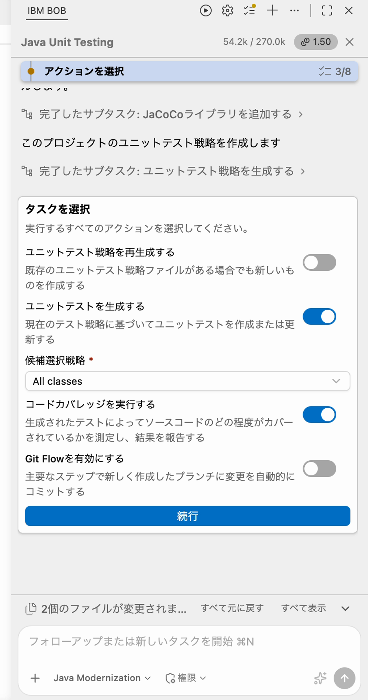
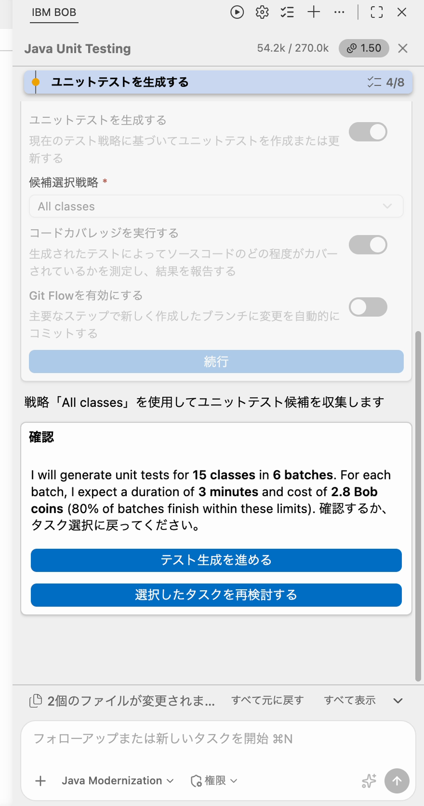
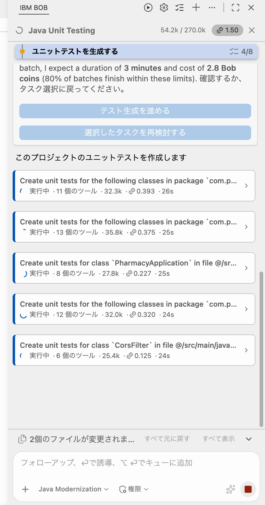
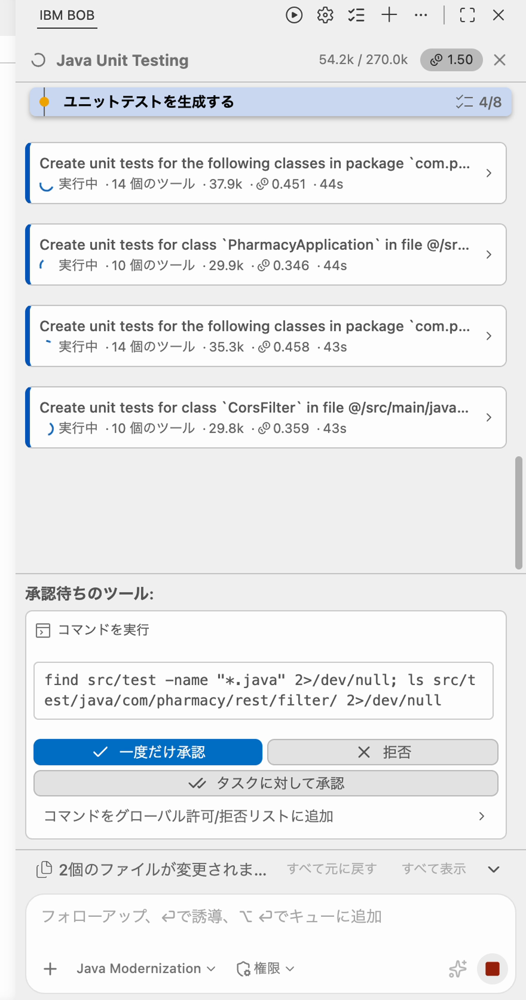
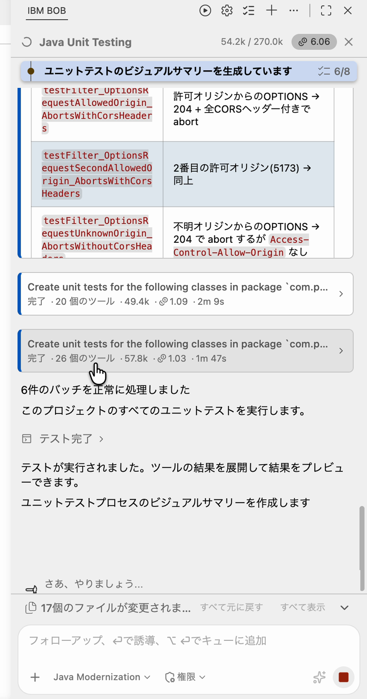
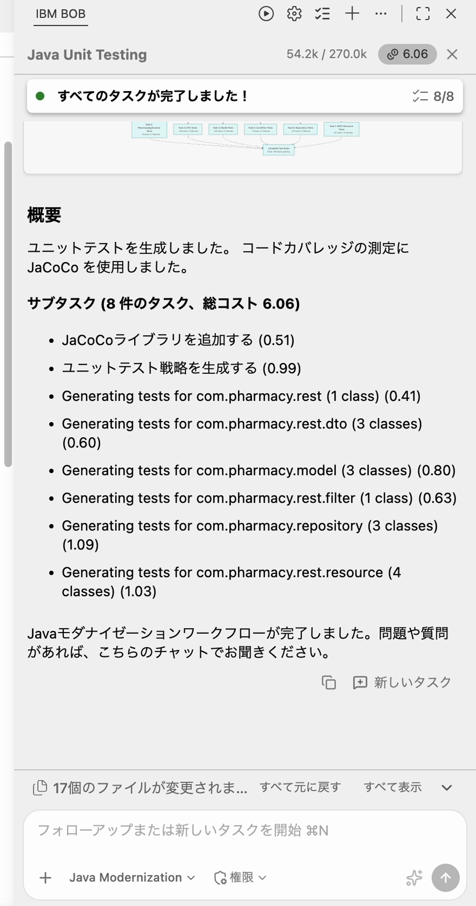

# Lab 4 — ユニットテストの生成

## Simple Pharmacy Dashboard：包括的なテストカバレッジの実現

---

## 目次

1. [はじめに](#1-はじめに)
2. [前提条件](#2-前提条件)
3. [ワークフローの仕組み](#3-ワークフローの仕組み)
4. [自動承認の設定](#4-自動承認の設定)
5. [セットアップ](#5-セットアップ)
6. [演習 1：Java Unit Testing ワークフローを実行する](#6-演習-1java-unit-testing-ワークフローを実行する)
7. [演習 2：テスト戦略と結果を確認する](#7-演習-2テスト戦略と結果を確認する)
8. [ヘルプ](#8-ヘルプ)
9. [トラブルシューティング](#9-トラブルシューティング)
10. [まとめ](#10-まとめ)

---

## 1. はじめに

### ユニットテスト生成とは

ユニットテスト生成は、アプリケーションの個々のコンポーネントが単体で正しく動作することを確認する自動テストを作成するプロセスです。

- **テストケース設計**: 何をどのようにテストするか特定
- **モックの作成**: テスト対象を依存関係から分離
- **アサーションの記述**: 期待される動作の検証
- **エッジケースのカバー**: 境界条件とエラーシナリオのテスト
- **テストの整理**: 保守性を考慮したテスト構造の設計

Bob の **Java Unit Testing** ワークフローは、このプロセス全体を自動化します。プロジェクトを分析し、テスト戦略を文書として作成し、JaCoCo によるコードカバレッジを設定し、Mockito モックと AssertJ アサーションを使った JUnit 5 テストを生成して実行し、カバレッジのベースラインを報告します。

### このラボについて

スタンドアロンの **Java Unit Testing** ワークフローを使って、薬局アプリに包括的なテストスイートを追加します。

| 項目 | 内容 |
|------|------|
| **移行前** | Liberty ランタイム、Java 21、React フロントエンド、テストなし |
| **移行後** | 同じコードベースに JUnit 5 テストスイート、JaCoCo カバレッジ、`UNITTEST.md` 戦略ファイルを追加 |

### テスト対象コンポーネント

**REST API リソース**（PrescriptionResource、OrderResource、MedicineResource、DashboardResource）

- HTTP エンドポイントの動作
- リクエスト/レスポンスの処理
- エラーシナリオ
- ステータスコードの検証

**リポジトリクラス**（PrescriptionRepository、OrderRepository、MedicineRepository）

- CRUD 操作
- 検索・フィルター機能
- データの整合性
- 並行アクセスのシナリオ

**モデルクラス**（Prescription、Order、Medicine）

- コンストラクタの検証
- ゲッター/セッターの動作
- ビジネスロジックのメソッド

### テスト技術スタック

| ツール | 用途 |
|--------|------|
| **JUnit 5** | モダンなテストフレームワーク |
| **Mockito** | 依存関係のモッキングフレームワーク |
| **Maven Surefire** | テストの実行とレポート |
| **JaCoCo** | コードカバレッジの計測とレポート |

### 学習目標

このラボを完了すると、次のことができるようになります。

- スタンドアロンの Java Unit Testing ワークフローを起動してテスト生成スコープを選択できる
- タスク選択画面の各オプションを理解できる
- Bob が生成した `UNITTEST.md` テスト戦略ファイルを読んで内容を理解できる
- コスト/時間のプレビューと 80% 信頼区間を解釈できる
- `mvn clean test` でテストスイートを実行して結果を解釈できる
- JaCoCo コードカバレッジレポートを生成してクラスごとのカバレッジを確認できる

---

## 2. 前提条件

### IBM Bob IDE

Java プレミアムパッケージを含む最新の IBM Bob IDE 拡張機能をインストール済みで、ログインしていること。

### ターミナル環境（macOS zsh）

SDKMAN が設定されていることを確認します。

```bash
sdk version
```

設定されていない場合:

```bash
curl -s "https://get.sdkman.io" | bash
echo '[[ -s "$HOME/.sdkman/bin/sdkman-init.sh" ]] && source "$HOME/.sdkman/bin/sdkman-init.sh"' >> ~/.zshrc
source ~/.zshrc
```

### Java 21

**動作確認済み（Apple Silicon）**: `21.0.11-zulu`

```bash
sdk install java 21.0.11-zulu
sdk use java 21.0.11-zulu
java -version  # 21 と表示されることを確認
```

### Maven

```bash
mvn -v  # インストール済みか確認
# インストールされていない場合:
sdk install maven
```

!!! note "Java バージョンの注意"
    `mvn -version` を実行すると、Maven がビルドに使用する Java バージョンが表示されます。システムのデフォルトとは異なる場合があります。Maven は `JAVA_HOME` 環境変数または SDKMAN! が設定した Java を使用します。バージョンが異なる場合は、`JAVA_HOME` を明示的に設定するか、`sdk use java 21.0.11-zulu` を再実行してください。

### Bob の再起動

Maven のインストール後、Bob を完全に終了して再起動してください。

---

## 3. ワークフローの仕組み

ワークフローを実行する前に、Bob が内部で何をしているか理解しておきましょう。**Java Unit Testing** ワークフローは 9 つのフェーズで進行します。

| フェーズ | 内容 |
|---------|------|
| **1. プロジェクト分析** | プロジェクト構造、ビルドツール、既存のテストインフラ（JUnit バージョン、JaCoCo、Surefire プラグイン）をスキャン |
| **2. テスト戦略生成** | `UNITTEST.md` 戦略ドキュメントを作成。命名規則、モッキングアプローチ、分離ルール、スコープを定義 |
| **3. タスク選択画面** | **ユニットテスト戦略を再生成する**、**ユニットテストを生成する**、**コードカバレッジを実行する**、**Git Flowを有効にする** のオン/オフを選択。**候補選択戦略**ドロップダウン（スクリーンショットでは All classes）も設定 |
| **4. コスト/時間プレビュー** | 高コストの操作前に、期待される所要時間と Bob コインのコストを **80% 信頼区間**で表示 |
| **5. テスト生成（バッチサブエージェント）** | パッケージ/バッチごとに並行サブエージェントを起動し、各サブエージェントが本番クラスと `UNITTEST.md` を読んで JUnit 5 テストを記述 |
| **6. ビルドと依存関係の更新** | 不足しているテスト依存関係（junit-jupiter、mockito-core、mockito-junit-jupiter、JAX-RS ランタイム）を必要に応じて `pom.xml` に追加 |
| **7. 自己修正リカバリータスク** | ビルド Issues が発生した場合（古い .class ファイル、インクリメンタルコンパイルの競合など）、計画外のリカバリーサブタスクを追加して自律的に修正 |
| **8. テスト実行と検証** | `mvn test` を実行し、失敗を修正してから次に進む。常にグリーンのテストスイートを維持 |
| **9. カバレッジレポート** | JaCoCo 有効でフルスイートを実行し、クラスごとの命令カバレッジを表示。残存するギャップを強調表示 |

---

## 4. 自動承認の設定

チャットウィンドウの権限セレクターで Bob が自動実行できる操作を制御できます。

| 権限 | 内容 |
|------|------|
| **Read** | ファイルの読み取りを自動実行 |
| **Edit** | ファイルの編集を自動実行 |
| **Execute** | コマンドの実行を自動実行 |
| **MCP** | MCP の機能を自動実行 |

!!! tip "新しいユーザーへのヒント"
    慣れるまでは「Read のみ」を有効にして、Bob が何をしているかを把握しながら進めましょう。

---

## 5. セットアップ

### 0. スナップショットを取得する

Bob に以下をお願いしてください。

> 以下の URL から Lab 4 用のスナップショットをダウンロードして展開してください。
>
> `https://raw.githubusercontent.com/r-nakayamasan/bob-workshop-draft/main/snapshots/snapD-unit-test-gen.zip`
>
> ダウンロードして `~/lab-workspace/` に展開してください。

Bob が自動で以下のコマンドを実行します（Mac/Windows どちらでも動作します）：

```bash
# ダウンロード
curl -L -o snapD.zip "https://raw.githubusercontent.com/r-nakayamasan/bob-workshop-draft/main/snapshots/snapD-unit-test-gen.zip"

# 展開
python -m zipfile -e snapD.zip ./lab-workspace/
```

!!! tip "作業フォルダの場所"
    展開先は任意の場所で構いません。`~/lab-workspace/` の部分はお好みのパスに変更してください。

### 1. スナップショットフォルダを IDE で開く

- IBM Bob を起動する
- メニューバーから **File > Open Folder**
- 展開した **`snapD-unit-test-gen/`** フォルダに移動して **Open** をクリック

!!! warning "注意"
    `snapD-unit-test-gen` フォルダをそのままルートとして開いてください。

### 2. Agent モードを確認する

Bob のチャットパネル下部が **Agent** と表示されていることを確認します。

### 3. ワークフローが表示されることを確認する

Bob のチャットパネルのワークフロー一覧に **Java Unit Testing** が表示されていることを確認します（別のワークフローの中ではなく、トップレベルのワークフローとして表示されます）。

---

## 6. 演習 1：Java Unit Testing ワークフローを実行する

### 目的

Java Unit Testing ワークフローを使い、薬局アプリに JaCoCo によるコードカバレッジの計測を追加して、テスト戦略ファイル `UNITTEST.md` と JUnit 5 のユニットテストを生成します。Bob がどの順番で何を行い、どこで人の判断（タスクの選択やコマンドの承認）が必要になるかを確認しながら進めましょう。

### 手順

ワークフロー実行中は、チャット上部に現在のサブタスクと進捗（例: `4/8`）が表示されます。Bob が自律的に進める部分と、**人が判断する部分** が交互に現れるので、画面下部の「承認待ちのツール」や選択ボタンを見逃さないようにしてください。

!!! note "画面の見た目について"
    このページのスクリーンショットは日本語 UI の IBM Bob で撮影したものです。コスト、所要時間、テストの件数、バッチの構成は実行ごとに異なります。本文中の数値は「スクリーンショットの例では…」として示しています。お使いの環境の表示と一致しなくても問題ありません。

---

#### ステップ 1：ワークフローを開始する

チャットウィンドウ上部の再生ボタン（▶）で **Bobワークフロー** 一覧を開き、**Java Unit Testing** カードの **開始** をクリックします。



一覧には **Java Modernization**、**Java Unit Testing**、**Java Vulnerability Remediation** の 3 つのワークフローが表示されます。Java Unit Testing カードの下向きの矢印（∨）を押すと、「Javaアプリケーションのユニットテストの実行、更新、作成を支援し、コードカバレッジを高め…」という説明が展開されます。このラボでは **Java Unit Testing** を使います。

---

#### ステップ 2：自動セットアップ（JaCoCo の追加）

ワークフローを開始すると、Bob はまず **初期化** を実行し、続けて **JaCoCoライブラリを追加する** サブタスクを自動的に起動します。このステップで操作は不要です。



スクリーンショットの例では、次の流れで進みました。

1. **検出**: 「このプロジェクトにコードカバレッジツールが見つかりませんでした」と判断し、レポート用に JaCoCo ライブラリをインストールすると表示されます。
2. **ビルドファイルの確認**: Maven 3.9.16、Java 21、シングルモジュール構成を検出します。Java 21 に対応する JaCoCo は 0.8.11 以上が必要なので、**0.8.15** を使うと判断しています。
3. **pom.xml の変更**: JaCoCo 0.8.15 を `pom.xml` に直接追加し、「pom.xmlに差分を適用しました」と表示されます。
4. **インストールの確認**: テストを実行して JaCoCo のカバレッジレポートが生成されることを確認し、「テスト完了」と表示されます。

この間、スクリーンショットの範囲では承認プロンプトは表示されませんでした。完了したサブタスクは「完了したサブタスク: JaCoCoライブラリを追加する」のように残り、続けてテスト戦略の作成に進みます。

---

#### ステップ 3：テスト戦略（UNITTEST.md）を作成する

JaCoCo の追加が終わると、Bob は **ユニットテスト戦略を生成する** サブタスクを実行します。プロジェクトの構造を探索し、既存のテストファイルがないことを確認してから、テスト戦略ファイル **`UNITTEST.md`** を作成します。



スクリーンショットの例では、次の順で進みました。

- プロジェクトの探索（ファイルの一覧表示、「探索完了 1個のツール, 15個のファイル, 1個のフォルダー」など）
- 「現在テストファイルが存在しないことを確認できました。すべての情報が揃ったので、`UNITTEST.md` を作成します。」
- 「ファイルUNITTEST.mdを書き込みました」

作成された `UNITTEST.md` は英語で書かれています。エディタで開いたスクリーンショットの例では、目次は次の 6 項目でした。



1. Project Architecture Overview
2. Unit Testing Approach by Module
3. Test File Paths and Naming Conventions
4. Test Commands
5. Recommended Frameworks and Libraries
6. Test Quality Metrics and Coverage Thresholds

!!! tip "確認のポイント"
    タスク選択画面の「ユニットテストを生成する」の説明には「現在のテスト戦略に基づいて」とあります。つまり、この `UNITTEST.md` の内容が以降のテスト生成の基準になります。アーキテクチャ（REST・DTO・Model・Repository などのレイヤー）、テストファイルの配置、テストコマンドが書かれているかを確認しておきましょう。

---

#### ステップ 4：タスクを選択する

`UNITTEST.md` の作成が完了すると、Bob は **タスクを選択** フォームを表示します。ここで、この実行で行うアクションを選びます。戦略ファイルはすでに作成済みなので、**ユニットテスト戦略を再生成する** はオフのままにします。

| 項目 | 画面の説明 | 設定 |
|------|-----------|------|
| **ユニットテスト戦略を再生成する** | 既存のユニットテスト戦略ファイルがある場合でも新しいものを作成する | オフ |
| **ユニットテストを生成する** | 現在のテスト戦略に基づいてユニットテストを作成または更新する | オン |
| **候補選択戦略**（必須） | ドロップダウンで選択します | All classes |
| **コードカバレッジを実行する** | 生成されたテストによってソースコードのどの程度がカバーされているかを測定し、結果を報告する | オン |
| **Git Flowを有効にする** | 主要なステップで新しく作成したブランチに変更を自動的にコミットする | オフ |



設定を確認したら **続行** をクリックします。続行するとフォームは淡色表示になり、Bob は「戦略「All classes」を使用してユニットテスト候補を収集します」と表示して、次の確認に進みます。

---

#### ステップ 5：コスト/時間プレビューを確認する

続行すると、Bob は **確認** カードを表示し、生成するユニットテストの規模と見込みを示します。テスト生成を始める前に、ここで内容を確認しましょう。スクリーンショットの例では、次のメッセージが表示されました。

> I will generate unit tests for **15 classes** in **6 batches**. For each batch, I expect a duration of **3 minutes** and cost of **2.8 Bob coins** (80% of batches finish within these limits). 確認するか、タスク選択に戻ってください。



カードには次の 2 つのボタンがあります。

| ボタン | 動作 |
|--------|------|
| **テスト生成を進める** | 表示された内容でテスト生成を開始します。 |
| **選択したタスクを再検討する** | タスク選択画面に戻り、設定を変更します。 |

!!! info "80% の意味"
    「80% of batches finish within these limits」は、**バッチの約 8 割が表示された所要時間とコストの範囲内で完了する見込み** という意味です。残りの約 2 割は、これより時間がかかったりコストが高くなることがあります。これは見積もりであり、保証ではありません。

---

#### ステップ 6：バッチでユニットテストを生成する

**テスト生成を進める** をクリックすると、Bob はクラスを **バッチ** にまとめ、バッチごとにサブエージェントを並行して実行します。チャットには、バッチごとのカードが表示されます。



カードのタイトルは、パッケージ単位（`Create unit tests for the following classes in package ...`）または 1 クラス単位（`Create unit tests for class ...`）で表示されます。各カードには、実行中のツール数、数値、Bob コイン、経過時間が表示されます。完了したカードを開くと、テストクラスごとのテストメソッドと検証シナリオの表が確認できます。

スクリーンショットの例では、最終的に **6 バッチ** が完了し、「6件のバッチを正常に処理しました」と表示されました。サマリーに記載されたバッチの内訳は次のとおりです。

| バッチ（パッケージ） | クラス数 |
|------|------|
| `com.pharmacy.rest` | 1 |
| `com.pharmacy.rest.dto` | 3 |
| `com.pharmacy.model` | 3 |
| `com.pharmacy.rest.filter` | 1 |
| `com.pharmacy.repository` | 3 |
| `com.pharmacy.rest.resource` | 4 |

!!! note "バッチの構成は実行ごとに変わります"
    バッチの数、分け方、表示の順番は実行ごとに変わります。上の表はスクリーンショットの例です。お使いの環境で同じ表示にならなくても問題ありません。

ビルドの Issues（古い `.class` ファイル、インクリメンタルコンパイルの競合）が発生した場合、Bob がリカバリーサブタスクを追加して自律的に修正します。

---

#### ステップ 7：コマンドの実行を承認する

バッチの実行中、Bob が **承認待ちのツール** としてコマンドの実行許可を求めて止まることがあります。スクリーンショットの例では、テストファイルを検索するコマンドの承認が求められました。

```bash
find src/test -name "*.java" 2>/dev/null; ls src/test/java/com/pharmacy/rest/filter/ 2>/dev/null
```



承認プロンプトには、次の 3 つのボタンと 1 つのリンクがあります。

| ボタン / リンク | 動作 |
|--------|------|
| **一度だけ承認** | このコマンドの実行を 1 回だけ承認します。 |
| **拒否** | このコマンドの実行を承認しません。 |
| **タスクに対して承認** | 現在のタスクに対して承認します。 |
| **コマンドをグローバル許可/拒否リストに追加** | このコマンドを、グローバルの許可/拒否リストに追加します。 |

!!! tip "最初は「一度だけ承認」から"
    このラボでは、まず **一度だけ承認** を選ぶと、Bob が何を実行するのかを確認しながら進めやすくなります。

---

#### ステップ 8：テストを実行し、結果を確認する

全バッチが完了すると、Bob はステップ **ユニットテストを実行する**（5/8）に進み、テストを実行します。チャットには「テストが実行されました。ツールの結果を展開して結果をプレビューできます。」と表示され、続けて **ユニットテストのビジュアルサマリー**（6/8）を作成します。



テストファイルごとに、テストメソッドと検証シナリオの表が表示されます（例: `CorsFilterTest.java` は 9 テストメソッド）。

テストの結果が自動的に表示されない場合や、JaCoCo カバレッジレポートが見当たらない場合は、以下のように依頼してください。

```
JaCoCo カバレッジレポートを生成してください。
```

---

#### ステップ 9：ワークフローのサマリーを確認する

すべてのタスクが完了すると、チャットに **すべてのタスクが完了しました！**（8/8）と表示され、サマリーが出力されます。途中の **モダナイゼーションのサマリー**（7/8）では、タスク全体の流れを図で確認できます。



サマリーには次の内容が含まれます。

- **概要**: 「ユニットテストを生成しました。コードカバレッジの測定に JaCoCo を使用しました。」
- **サブタスク**: 完了したタスクごとのコイン（例: JaCoCoライブラリを追加する (0.51)、ユニットテスト戦略を生成する (0.99)）と、総コスト（例: 6.06）
- **バッチごとの生成結果**: 「Generating tests for com.pharmacy.repository (3 classes)」のように、パッケージごとの行

!!! note "表示される文言について"
    サマリーの最後には「Javaモダナイゼーションワークフローが完了しました。」と表示されますが、このラボで実行しているのは Java Unit Testing ワークフローです。文言は Bob の出力をそのまま示しています。

!!! info "コストの見方"
    スクリーンショットの例では、総コストは 6.06 コインでした。実行ごとに金額は変わるため、プレビューの金額と比べるときは、**どのタスクにどれだけのコストがかかったか** に注目してください。

---

## 7. 演習 2：テスト戦略と結果を確認する

### 1. `UNITTEST.md` を読む

プロジェクトルートにある `UNITTEST.md` を開きます。Bob の戦略ドキュメントには以下が含まれます。

- アプリケーションアーキテクチャのサマリー
- テスト可能なクラスとその責務
- 命名規則
- テストファイルのパス
- カバレッジ閾値（目標であり保証ではない）
- P1/P2/P3 で優先順位付けされたギャップの特定

### 2. テストスイートを自分で実行する

Bob のターミナルで:

```bash
mvn clean test
```

Bob が報告した合格率と同じ結果になることを確認します。

### 3. カバレッジレポートを開く

```bash
mvn jacoco:report
open target/site/jacoco/index.html
```

パッケージレベルのカバレッジ数値を Bob が報告したベースラインと比較します。

### 4. 生成されたテストファイルを探索する

生成されたテストファイルをいくつか開いてみましょう（例: `src/test/java/com/pharmacy/repository/PrescriptionRepositoryTest.java`）。

以下の点に注目してください。

- `@ExtendWith(MockitoExtension.class)` の使用
- `@Mock` と `@InjectMocks` アノテーション
- AssertJ のフルーエントアサーション

リポジトリがシングルトンパターンを使用している場合、Bob がそれをどうモックしているかを確認してください。よく使われる手法は、`MockedStatic` とリフレクションを組み合わせてプライベートなシングルトンフィールドを上書きする方法です。

---

## 8. ヘルプ

### ラボ中のサポート

1. **Bob に聞く**: テストの概念の説明、失敗したテストの修正、生成されたコードのレビューを依頼できます
2. **インストラクターに聞く**: 迷ったら遠慮なく質問してください
3. **クラスメートと協力する**: テストアプローチについて議論しましょう

### Bob 活用のヒント

- Bob が実行するアクションに注目して理解を深めましょう
- 不明なテストパターンがあれば Bob に説明を求めましょう
- 生成後にテストスイートの有効性分析を依頼しましょう
- 個々のテストのレビューと改善を Bob に依頼しましょう

---

## 9. トラブルシューティング

### API リクエストが失敗した

**症状**:

```
{"apiProtocol":"openai"}
```

**対処法**: Bob チャットウィンドウの **Retry** を選択します。

---

### `mvn test` で "cannot find symbol" またはクラスが見つからない

**症状**: テストクラスが Bob が存在すると思っているソースクラスを参照しているがコンパイルが失敗する

**対処法**: 前回の実行の古い `.class` ファイルが原因の可能性があります。`mvn test` ではなく `mvn clean test` を実行して完全な再コンパイルを強制してください。

---

### モックのインジェクション失敗

**症状**: モックされたオブジェクトにアクセスするとテストで NullPointerException が発生する

**対処法**:

1. テストクラスに `@ExtendWith(MockitoExtension.class)` があることを確認
2. `@Mock` と `@InjectMocks` アノテーションが正しいことを確認
3. 拡張機能を使用しない場合、`@BeforeEach` でモックが初期化されていることを確認
4. Bob にモックのセットアップをレビューしてもらう

---

### シングルトン状態によるテスト失敗

**症状**: テストを個別に実行すると合格するが、一緒に実行すると失敗する

**対処法**:

1. リポジトリのシングルトンがテスト間で状態を維持している
2. リポジトリにリセットメソッドを追加するか、リフレクションでインスタンスをリセット
3. Bob に適切なテスト分離の実装を依頼
4. 適切なクリーンアップを伴う `@TestInstance(Lifecycle.PER_CLASS)` の使用を検討

---

### JaCoCo カバレッジレポートが生成されない

**症状**: 実行後に `target/site/jacoco/` ディレクトリが存在しない

**対処法**: `mvn clean test jacoco:report` を実行します。カバレッジレポートには `jacoco:report` ゴールが明示的に必要です。`mvn test` のみでは生成されません。

---

### Bob のターミナルで Java バージョンが異なる

**症状**: Bob のターミナルで `java -version` が 21 以外のバージョンを表示する

**対処法**: Bob のターミナルで以下を実行します。

```bash
sdk use java 21.0.11-zulu
```

`sdk use` はシェルスコープのため、ターミナルタブや Bob が独立して開くターミナルには適用されません。

---

## 10. まとめ

おめでとうございます！Bob の Java Unit Testing ワークフローを使ってユニットテスト生成ラボを完了しました。

- ✅ スタンドアロンの Java Unit Testing ワークフローの起動
- ✅ タスク選択画面の設定（戦略、テスト、カバレッジ、Git フロー）
- ✅ 80% 信頼区間を含む Bob のコスト/時間プレビューの解釈
- ✅ `UNITTEST.md` 戦略ドキュメントのレビューと構造の理解
- ✅ `mvn clean test` によるテストスイートの実行
- ✅ JaCoCo カバレッジレポートの生成とクラスごとの内訳の確認

### 重要なポイント

1. **早期テスト、頻繁なテスト**: 自動テストは本番環境に到達する前にバグを発見する
2. **包括的なカバレッジ**: 正常パス、エラーパス、エッジケースをテストする
3. **適切な分離**: モックを使って実際の依存関係なしにユニットをテストする
4. **読みやすいテスト**: 明確なテスト名とアサーションで保守性を高める
5. **高速な実行**: ユニットテストは頻繁な使用を促すために素早く実行できるべき
6. **Bob のテスト専門知識**: AI は包括的なテストスイートを効率的に生成できるが、出力のレビューと理解もプロセスの一部

次は **[Lab 5 — 脆弱性の検出と修正](java_premium_lab5.md)** に進みましょう。
