# Lab 5 — 脆弱性の検出と修正

## Simple Pharmacy Dashboard：依存ライブラリの CVE スキャンと修正

---

## 目次

1. [はじめに](#1-はじめに)
2. [前提条件](#2-前提条件)
3. [V2 の注目機能](#3-v2-の注目機能)
4. [セットアップ](#4-セットアップ)
5. [演習 1：Java Vulnerability Remediation ワークフローを実行する](#5-演習-1java-vulnerability-remediation-ワークフローを実行する)
6. [演習 2：CVE の検出結果を確認する](#6-演習-2cve-の検出結果を確認する)
7. [演習 3：検出された脆弱性を修正する](#7-演習-3検出された脆弱性を修正する)
8. [演習 4：修正後のアプリケーションを確認する](#8-演習-4修正後のアプリケーションを確認する)
9. [トラブルシューティング](#9-トラブルシューティング)
10. [まとめ](#10-まとめ)

---

## 1. はじめに

### 依存ライブラリの脆弱性検出とは

すべての Java アプリケーションは、直接的（`pom.xml` に宣言）または間接的（他のライブラリ経由で取り込まれる推移的依存関係）にサードパーティライブラリに依存しています。これらのライブラリはいずれも、CVE として公開された既知のセキュリティ脆弱性を持つ可能性があります。

依存ライブラリの脆弱性検出は以下のプロセスです。

- **スキャン**: 直接・推移的なすべての依存関係を確認
- **照合**: 公開された CVE データベースと照合
- **報告**: 各一致について深刻度・影響バージョン・修正推奨事項を報告
- **修正**: 脆弱性のある依存関係をアップグレードまたは除外

### このラボについて

**Bob V2 の Java Vulnerability Remediation ワークフロー**を使って、薬局アプリケーションの依存関係をスキャンし、検出結果を読み取り、脆弱性のあるライブラリをアップグレードして修正します。

| 項目 | 内容 |
|------|------|
| **修正前** | `pom.xml` に脆弱性のある依存関係バージョンが含まれる薬局アプリ |
| **修正後** | 脆弱性のある依存関係をアップグレード済み、修正後のビルドとテストが成功し、修正内容をまとめた HTML レポートが作成された同アプリ |

### 学習目標

このラボを完了すると、次のことができるようになります。

- Java Vulnerability Remediation ワークフローを起動し、進捗と検出結果を読める
- 直接依存関係と推移的依存関係の脆弱性の違いを理解できる
- 修正するかどうかの選択と、Bob が実行するコマンドの承認を行える
- 修正後もアプリがビルドでき、テストが成功していることを確認できる

---

## 2. 前提条件

### IBM Bob IDE（V2）

- 最新の Bob V2 IDE 拡張機能をインストール済みであること
- Java Vulnerability Remediation ワークフローが含まれる Premium パッケージのサブスクリプションが必要

### ターミナル環境（macOS zsh）

```bash
# SDKMAN が未設定の場合:
curl -s "https://get.sdkman.io" | bash
echo '[[ -s "$HOME/.sdkman/bin/sdkman-init.sh" ]] && source "$HOME/.sdkman/bin/sdkman-init.sh"' >> ~/.zshrc
source ~/.zshrc
```

### Java 21

**動作確認済み（Apple Silicon）**: `21.0.11-zulu`

```bash
sdk install java 21.0.11-zulu
sdk use java 21.0.11-zulu
```

### Maven

```bash
sdk install maven
```

### Bob の再起動

Maven インストール後に Bob を完全に終了して再起動してください。

!!! note
    このラボはバックエンドのみです。Node.js と npm は不要です。

---

## 3. V2 の注目機能

このラボで注目すべき Bob V2 の機能です。

| 機能 | 説明 |
|------|------|
| **トップレベルのスタンドアロンワークフロー** | Java Vulnerability Remediation は、ワークフロー一覧で Java Modernization や Java Unit Testing と並ぶ専用のワークフロー |
| **高速な脆弱性照会** | 依存関係の脆弱性照会は数秒で完了（スクリーンショットの例では 54 個の依存関係を数秒で照会）。修正と検証を含むワークフロー全体では数分かかる（例：約 5 分） |
| **依存関係の範囲とスコープ** | 検出結果のレポートに影響を受けるパッケージとスコープ（例：`test`）が表示される。推移的依存関係は修正後の検証で確認する |
| **承認つきの修正フロー** | 修正を進めるかどうかを 1 回選び、その後 Bob が修正と検証を進める。コマンドの実行は、承認待ちのツールとして確認を求められる |
| **タスクごとのコスト** | サブタスクごとにツール数・トークン数・コストを表示し、チャット上部にワークフロー全体のコストを表示 |

---

## 4. セットアップ

### 0. スナップショットを取得する

Bob に以下をお願いしてください。

> 以下の URL から Lab 5 用のスナップショットをダウンロードして展開してください。
>
> `https://raw.githubusercontent.com/r-nakayamasan/bob-workshop-draft/main/snapshots/snapE-security-vulnerabilities.zip`
>
> ダウンロードして `~/lab-workspace/` に展開してください。

Bob が自動で以下のコマンドを実行します（Mac/Windows どちらでも動作します）：

```bash
# ダウンロード
curl -L -o snapE.zip "https://raw.githubusercontent.com/r-nakayamasan/bob-workshop-draft/main/snapshots/snapE-security-vulnerabilities.zip"

# 展開
python -m zipfile -e snapE.zip ./lab-workspace/
```

!!! tip "作業フォルダの場所"
    展開先は任意の場所で構いません。`~/lab-workspace/` の部分はお好みのパスに変更してください。

### 1. スナップショットフォルダを IDE で開く

展開した **`snapE-security-vulnerabilities/`** フォルダをプロジェクトルートとして開いてください。

!!! warning "注意"
    `snapE-security-vulnerabilities` フォルダをそのままルートとして開いてください。ワークフローはスナップショットレベルでのみ表示されます。

### 2. チャット入力欄の下部を確認する

Bob のチャット入力欄の下部に、選択欄（スクリーンショットでは **Java Modernization**）と **権限** が表示されていることを確認します。

### 3. ワークフローが表示されることを確認する

Bob のチャットパネル上部の再生ボタン（▶）をクリックすると **Bobワークフロー** の一覧が開きます。「すべてのワークフロー」に **Java Vulnerability Remediation** が表示されていることを確認します。

---

## 5. 演習 1：Java Vulnerability Remediation ワークフローを実行する

### 目的

ワークフローを起動して、Bob に依存関係の脆弱性の照会を実行させ、修正を進めるかどうかを選びます。

### 手順

ワークフローの実行中は、チャット上部に現在のサブタスク名と進捗（`2/9` のような表示）が出ます。Bob が自動で進める部分と、**人が判断する部分**（修正を進めるかの選択、コマンドの承認）が交互に現れるので、画面下部の「承認待ちのツール」や選択肢を見逃さないようにしてください。

!!! note "画面の見た目について"
    このページのスクリーンショットは日本語 UI の Bob V2 で撮影したものです。収録では **snapB-java-upgrade** というプロジェクトを使っているため、プロジェクト名、依存関係の件数、検出される脆弱性、コストは、このラボの `snapE-security-vulnerabilities` で表示される内容とは異なります。画面の数値は例として読んでください。

#### ステップ 1：ワークフローを開始する

チャットパネル上部の再生ボタン（▶）で **Bobワークフロー** の一覧を開き、**Java Vulnerability Remediation** カードの **開始** をクリックします。カード右端の ∨ を押すと、ワークフローの説明（OSV データベース（osv.dev）を使って、Java アプリケーション内のオープンソース JAR に既知の脆弱性がないかをスキャンし、修正バージョンを取得する、という内容）が展開されます。

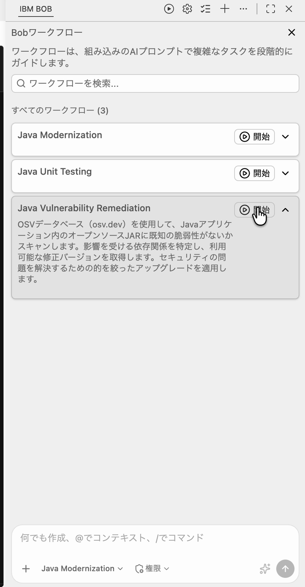

**裏側の処理**

Bob は開始すると、チャットに対象プロジェクトのパスを表示し、「脆弱性を検出する」のサブタスクを始めます。

!!! tip "確認ポイント"
    チャットに表示されるプロジェクトのパスが、手順 1 で開いた `snapE-security-vulnerabilities` のフォルダになっていることを確認してください。

#### ステップ 2：依存関係の検出と脆弱性の照会

Bob はプロジェクトの依存関係を検出し、固有の依存関係ごとに脆弱性を照会します。スクリーンショットの例では **54 個** の固有の依存関係を照会していました。照会中は「脆弱性を照会中...」と表示されます。

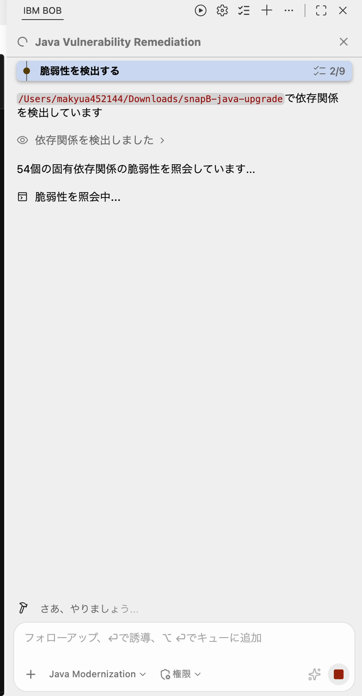

**裏側の処理**

1. **依存関係の検出**: 「依存関係を検出しました」として結果が折りたたまれて表示されます（展開すると内容を確認できます）
2. **脆弱性の照会**: OSV データベース（osv.dev）を使って脆弱性を照会します
3. **照会の完了**: 「脆弱性の照会が完了しました」と表示され、見つかった件数が出ます

スクリーンショットの例では、照会は数秒で終わりました。ワークフロー全体の時間は、このあとの修正と検証の分だけ長くなります。

#### ステップ 3：脆弱性の修正を選択する

照会が完了すると、Bob は「見つかった脆弱性：N」と件数を表示し、**脆弱性の修正** の選択肢を出します。「検出された脆弱性の修正を進めますか？」に対して、次のいずれかを選びます。

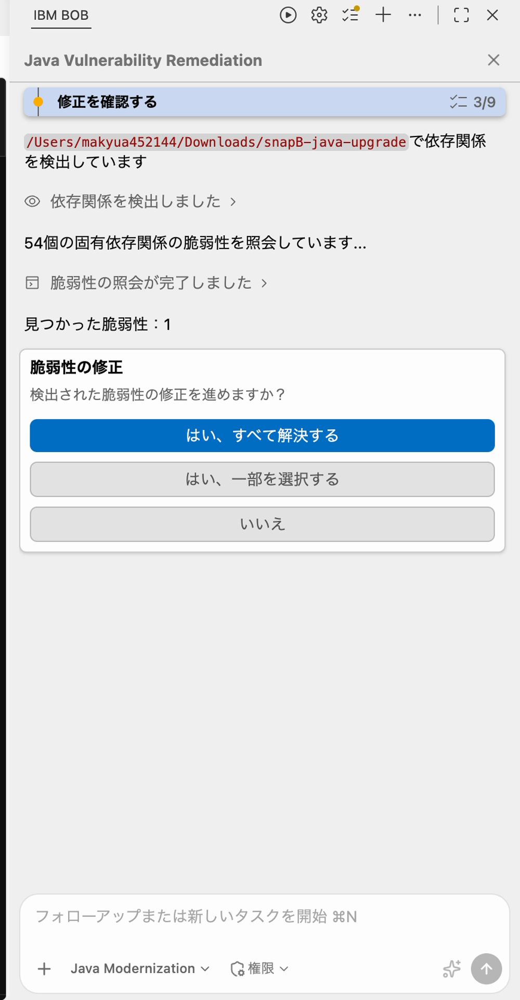

| ボタン | 動作 |
|--------|------|
| **はい、すべて解決する** | 検出された脆弱性をすべて修正対象にして、修正のサブタスクに進みます |
| **はい、一部を選択する** | この収録では選択していません |
| **いいえ** | この収録では選択していません |

このラボでは **はい、すべて解決する** を選びます。

#### ステップ 4：ワークフローの流れを把握する

**はい、すべて解決する** を選ぶと、Bob は残りの工程を続けて進めます。チャット上部のサブタスク名で、今どの工程かを確認できます。スクリーンショットの例では、次の順で進みました。

1. **脆弱性を検出する**（このステップ 2）
2. **修正を確認する**（ステップ 3）
3. **修正アプローチを計画する**（演習 3 のステップ 1）
4. **脆弱性を修正する**（演習 3）
5. **修正を検証する**（演習 4）
6. 完了サマリーの作成（英語表記：*Generating workflow summary*。演習 2）

---

## 6. 演習 2：CVE の検出結果を確認する

### 目的

Bob が見つけた脆弱性の内容（深刻度、スコープ、修正バージョン）を読み取り、対応の優先順位を考えます。

!!! note "読むタイミング"
    チャットには演習 1 の時点で「見つかった脆弱性：N」と件数だけが表示されます。詳しい検出結果のレポートは、修正と検証が終わったあとに作成されます。この演習は、演習 3 と演習 4 の内容を終えてから行ってください。

### 手順

#### ステップ 1：完了サマリーを開く

ワークフローが完了すると（スクリーンショットの例では **9/9**）、チャットに **Vulnerability Remediation Summary** のカードが表示されます。カードには「1 vulnerabilities detected — 3 tasks completed.」と表示されます。カード右下のボタンを押すと、検出結果をまとめた HTML レポートが開きます。

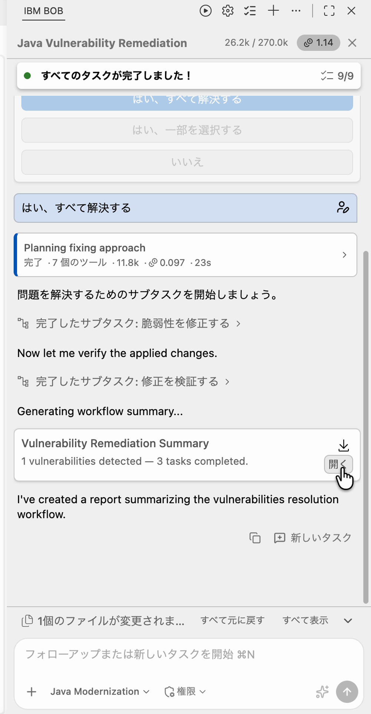

チャット上部には、ワークフロー全体のコストが表示されます（スクリーンショットの例では **1.14**）。サブタスクの一覧では、工程ごとのコストと時間を確認できます。例として、**修正アプローチを計画する** は 0.097、23 秒でした。また、画面下部には「1 個のファイルが変更されました」と変更数が表示され、**すべて表示** で変更ファイルの一覧を開けます。

#### ステップ 2：HTML レポートを読む

HTML レポートには、脆弱性ごとに次の情報が表形式で表示されます。スクリーンショットの例（1 件）は次のとおりです。

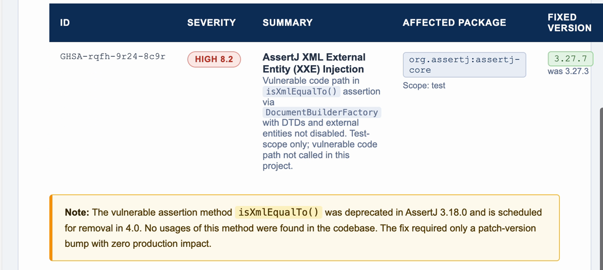

| 項目 | 例（スクリーンショットの値） | 見るポイント |
|------|------|------|
| **ID** | `GHSA-rqfh-9r24-8c9r` | 脆弱性の識別子。この例は CVE ではなく GHSA 形式の ID です |
| **SEVERITY** | HIGH 8.2 | 深刻度と数値 |
| **SUMMARY** | AssertJ XML External Entity (XXE) Injection | 脆弱性の概要 |
| **AFFECTED PACKAGE** | `org.assertj:assertj-core`（Scope: test） | 影響を受けるライブラリと、依存関係のスコープ |
| **FIXED VERSION** | 3.27.7（was 3.27.3） | 修正済みバージョンと、元のバージョン |

!!! tip "レポートの注意書き"
    レポートには、脆弱な API がプロジェクトで使われているかどうかの説明も含まれます。この例では、脆弱な `isXmlEqualTo()` を使うコードは見つからず、修正は影響の少ないパッチバージョンの更新だけで済む、と記載されていました。

#### ステップ 3：対応の優先順位を考える

次の観点で、どの脆弱性から対応するかを決めます。

!!! tip "確認ポイント"
    - **スコープ**: `test` は、テストのためだけに使われる依存関係です。本番のコードに入るかどうかは、スコープと利用箇所で判断します。
    - **深刻度と修正バージョン**: 深刻度の高いものや、バージョンを上げるだけで直せるものから確認すると効率的です。
    - **利用箇所**: レポートの注意書きで、脆弱な API が使われているかを確認します。
    - **直接か推移的か**: 演習 4 の推移的依存関係の確認で見ます。

#### ステップ 4：わからない脆弱性を Bob に質問する

馴染みのない脆弱性については、Bob に直接質問しましょう。

```
CVE-XXXX-XXXX について平易な言葉で説明してください。このアプリケーションにどのような影響があるか教えてください。
```

Bob がその脆弱性の概要と実際への影響を説明します。

---

## 7. 演習 3：検出された脆弱性を修正する

### 目的

Bob が提案した修正を、承認を挟みながら適用する流れを理解します。

### 手順

#### ステップ 1：修正アプローチを計画する

**はい、すべて解決する** を選ぶと、Bob はサブタスク **修正アプローチを計画する**（画面上の英語表記は *Planning fixing approach*）を開始します。サブタスクのカードの ∨ を押すと、実行中のツールの内容（「Java 環境を読み込みました」「依存関係を検出中...」など）を確認できます。

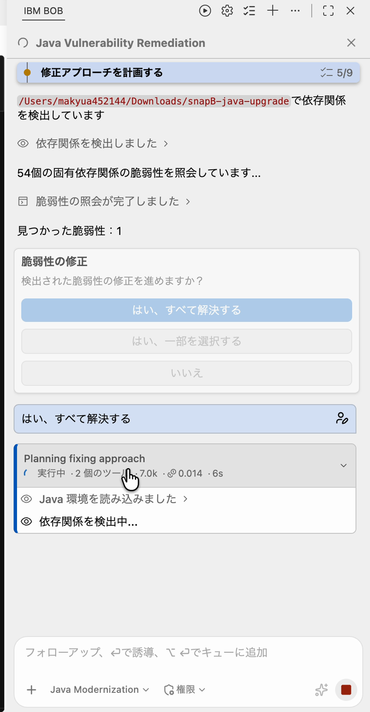

**裏側の処理**

- Java 環境の読み込み（「Java 環境を読み込みました」）
- 依存関係の検出と、修正対象のファイル（`pom.xml`）の探索（「パターン"**/pom.xml"のファイルが見つかりました」）

#### ステップ 2：pom.xml の変更内容を確認する

修正方針が決まると、Bob は **脆弱性を修正する** サブタスクで変更内容を説明し、`pom.xml` を編集します。スクリーンショットの例では、次の説明が表示されました。

> I'll fix the AssertJ XXE vulnerability by upgrading `org.assertj:assertj-core` from `3.27.3` to `3.27.7`.

そのあと Bob は `pom.xml` を読み取り、差分を適用しました。この収録では、`pom.xml` の変更について承認を求める表示はありませんでした。

!!! tip "確認ポイント"
    この収録では、`pom.xml` の変更に承認は求められず、そのまま適用されました。適用後の変更内容は、画面下部の **すべて表示** で確認できます（**すべて元に戻す** で元に戻すこともできます）。

#### ステップ 3：コマンドの実行を承認する

Bob は修正を確認するために Maven のコマンドを実行します。実行前に、画面下部に **承認待ちのツール** が表示されます。スクリーンショットの例では、`org.assertj:assertj-core` の解決を確認するコマンドでした。

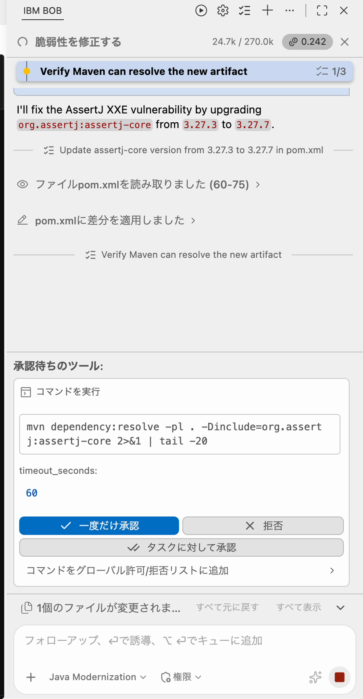

| ボタン | 動作 |
|--------|------|
| **一度だけ承認** | このコマンドだけ実行を許可します |
| **拒否** | このコマンドを実行させません |
| **タスクに対して承認** | このサブタスクの間は、同種のコマンドを確認なしで許可します |

承認待ちのツールには、コマンドの内容（例：`mvn dependency:resolve -pl . -Dinclude=org.assertj:assertj-core 2>&1 | tail -20`）と `timeout_seconds` が表示されます。「コマンドをグローバル許可/拒否リストに追加」は、この収録では使用していません。

コマンドが `pom.xml` を書き換えず、依存関係を解決するだけであることを確かめてから、**一度だけ承認** をクリックします。

#### ステップ 4：Todoリストで進捗を確認する

承認したコマンドが実行されると、Bob は `org.assertj:assertj-core:jar:3.27.7` を解決できたと報告し、次のテストに進みました。画面上部の **Todoリスト** には、修正の作業項目が英語で表示されます。

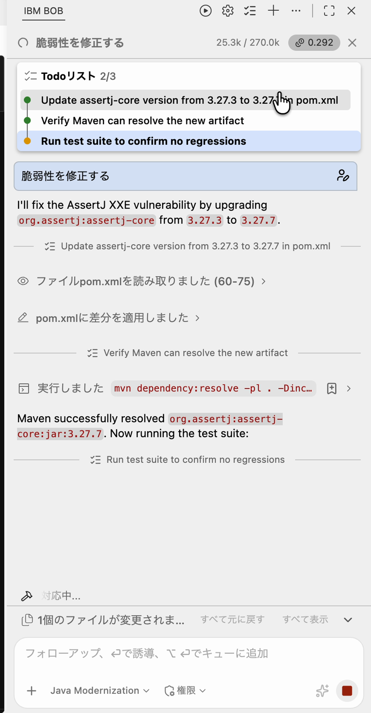

- Update assertj-core version from 3.27.3 to 3.27.7 in pom.xml
- Verify Maven can resolve the new artifact
- Run test suite to confirm no regressions

完了した項目は緑の点、実行中の項目は黄色の点で表示されます（スクリーンショットでは 2/3 が完了）。

#### ステップ 5：連鎖的な影響に対処する

修正によって二次的な問題が発生することがあります（例：新しいメジャーバージョンへのアップグレードが他の箇所の API 変更を必要とする）。その場合、Bob がこれらを特定して追加修正の承認を求めます。

!!! note
    この収録では、修正を求める追加の表示は出ませんでした。

---

## 8. 演習 4：修正後のアプリケーションを確認する

### 目的

修正後もビルドとテストが成功し、推移的依存関係に新たな問題がないことを確認します。

### 手順

#### ステップ 1：修正を検証するサブタスクを確認する

**脆弱性を修正する** が完了すると、Bob は **修正を検証する** サブタスクを開始します。スクリーンショットの例では、次の 4 つの作業で構成されていました。

1. Verify the assertj-core version in pom.xml has been updat...（pom.xml のバージョン更新を確認）
2. Verify the project builds successfully（プロジェクトがビルドできることを確認）
3. Run the test suite to confirm no regressions（テストを実行して回帰がないことを確認）
4. Check for transitive dependency conflicts（推移的依存関係の競合を確認）

（英語表記は Bob の出力そのままで、画面上で一部省略されています。日本語の説明は理解のための補足です。）

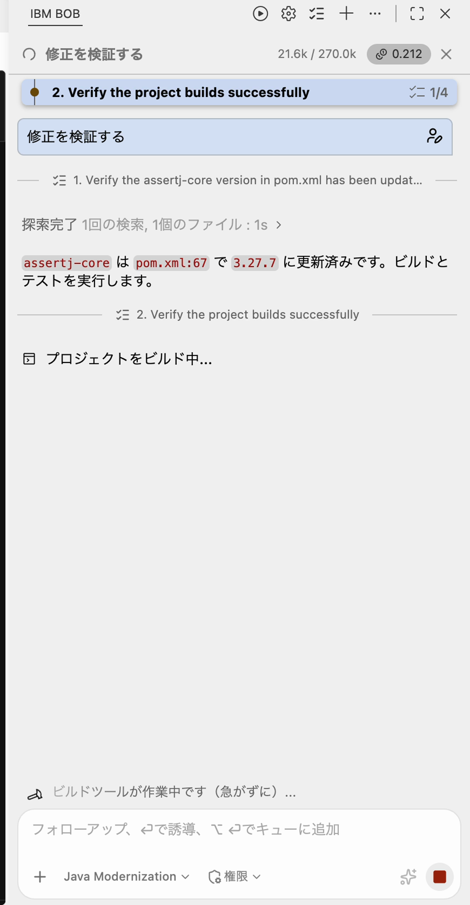

#### ステップ 2：ビルドの結果を確認する

Bob はプロジェクトをビルドし、結果を報告します。スクリーンショットの例では「ビルド完了」として、「ビルドはエラー・警告ゼロで成功。テストを実行します。」と表示されました。

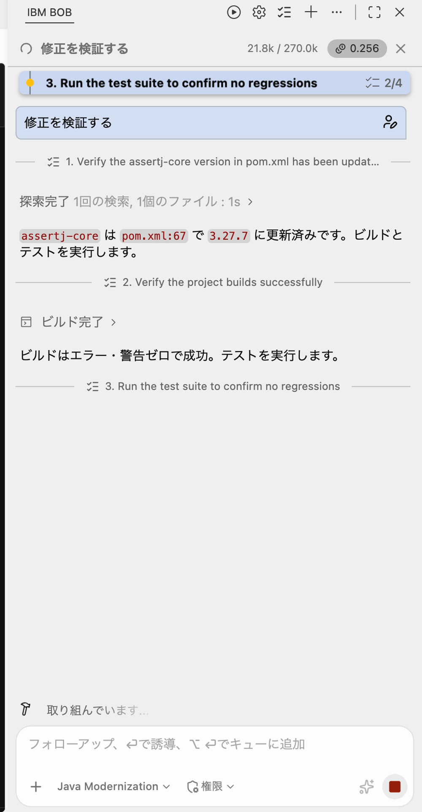

!!! tip "確認ポイント"
    ビルド結果の行で、エラーや警告の有無を確認しましょう。

#### ステップ 3：テストと推移的依存関係を確認する

テストは「全 165 テストがパス」と報告されました（スクリーンショットの例）。その後、Bob は推移的依存関係の確認に入り、`mvn dependency:tree` を実行するための承認を求めました。承認の操作は演習 3 のステップ 3 と同じです（**一度だけ承認**）。

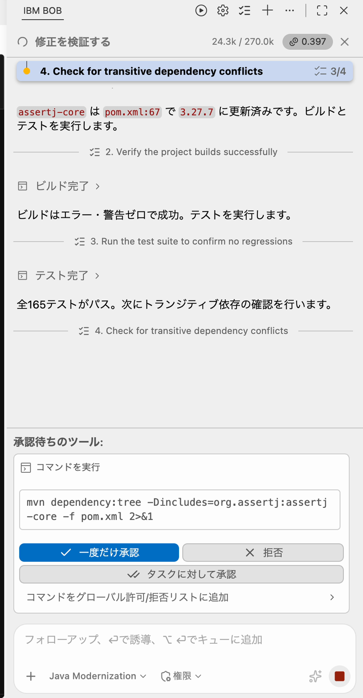

#### ステップ 4：検証結果を読む

Bob は依存関係の確認結果を次のように報告しました（スクリーンショットの例）。

- `assertj-core:3.27.7` は直接宣言されているだけで、ほかのライブラリから推移的に取り込まれていない
- `assertj-core` に関連する警告はない
- 表示された別の警告（`microprofile-openapi-api`、`junit-jupiter-api`）は、変更前から存在していた既存の状態

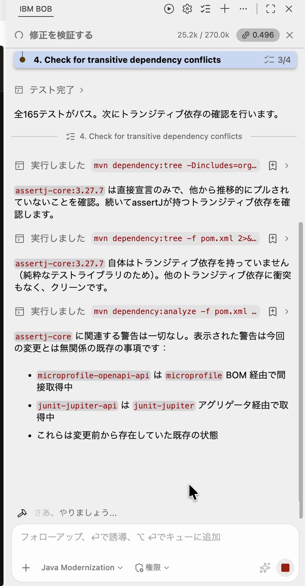

!!! tip "確認ポイント"
    修正と無関係の既存の警告が残ることがあります。修正対象のライブラリに関する警告が出ていないかを確認してください。

#### ステップ 5：手元でもコンパイルを確認する（任意）

Bob のターミナルで:

```bash
mvn clean compile
# BUILD SUCCESS が表示されることを確認
```

#### ステップ 6：ワークフローを再実行する

**Java Vulnerability Remediation** ワークフローの **開始** を再度クリックします。Bob が検出結果ゼロまたは大幅に減少したリストを報告するはずです。

#### ステップ 7（オプション）：Liberty サーバーを起動する

```bash
mvn liberty:run
```

アップグレードによるランタイムエラーなしに API が起動することを確認します。

```
http://localhost:9081/simple-pharmacy/api/dashboard
```

---

## 9. トラブルシューティング

### ワークフローが脆弱性ゼロと報告する

**症状**: Bob のスキャンが「検出されたパッケージに影響する脆弱性は見つかりませんでした」で完了する

**対処法**: これは正当な結果（クリーンな依存関係）の可能性もありますが、このラボでは `pom.xml` にラボが想定する意図的に脆弱なバージョンが含まれていないことを意味します。`snapE-*` の開始スナップショットを開いていること、かつ変更していないことを確認してください。

---

### バージョンアップ後に `mvn compile` が失敗する

**症状**: CVE の修正でライブラリが破壊的な API 変更を含むバージョンにアップグレードされ、コードがコンパイルできなくなる

**対処法**: コンパイルエラーを Bob に貼り付けて API の変更に対応するよう依頼します。Bob がコードを修正するか、（まだセキュアな）別のバージョンを提案します。

---

### 推移的依存関係がクリーンにアップグレードできない

**症状**: CVE が推移的依存関係内にあり、別のライブラリが古いバージョンを必要としているためシンプルなバージョンアップができない

**対処法**: Bob は通常、外部依存関係への `<exclusions>` ブロックと修正済みバージョンの直接宣言を提案します。プロンプトが表示されたら承認してください。

---

### Bob のターミナルで Java バージョンが異なる

**症状**: Bob のターミナルで `java -version` が 21 以外のバージョンを表示する

**対処法**: Bob のターミナルで以下を実行します。

```bash
sdk use java 21.0.11-zulu
```

`sdk use` はシェルスコープのため、ターミナルタブには適用されません。

---

## 10. まとめ

Bob V2 の専用ワークフローを使って、依存関係の脆弱性の検出から修正・検証までを完了しました。

- ✅ Java Vulnerability Remediation ワークフローの起動
- ✅ 検出結果（HTML レポート）の確認と、深刻度・スコープ・修正バージョンの把握
- ✅ 修正の選択と、コマンドの承認
- ✅ 修正後のビルドとテストの成功、推移的依存関係の確認
- ✅ 連鎖的な影響（破壊的なアップグレード、推移的な除外）への対処

これで Java Modernization ラボ 5 つをすべて完了しました！

---

## お疲れ様でした！

このワークショップでは IBM Bob を使って以下の Java モダナイゼーション作業を体験しました。

| ラボ | 達成内容 |
|-----|---------|
| **Lab 1** | Traditional WebSphere から Liberty ランタイムへの移行 |
| **Lab 2** | Java 8 から Java 21（Jakarta EE 10）へのアップグレード |
| **Lab 3** | Struts/JSP UI から React + Material UI への移行 |
| **Lab 4** | JUnit 5 + JaCoCo による 80% 以上のテストカバレッジの実現 |
| **Lab 5** | 依存ライブラリの CVE スキャンと脆弱性の修正 |
